# Bypass — AI dispatch co-pilot

<p align="center"></p>

[](https://github.com/0900B/ada-hackathon/actions/workflows/ci.yml)

**When something goes wrong in the field, a crew can simply say it in Slovenian. Bypass shows the dispatcher what is at risk and two or three simulated plans to approve. Every 112 call is dispatched the second it arrives, and an AI dispatcher reviews each case, with a human who can take over any decision.**

Bypass is our entry for **AdaHack 2026** (Ljubljana, "Code for change"), **Challenge 3 by Epilog: "Kaos na terenu. Vaša rešitev ponudi nov plan."** ("Chaos in the field. Your solution offers a new plan."): an AI assistant for unexpected events in emergency medical transport. The full brief is in [docs/CHALLENGE.md](docs/CHALLENGE.md).

It is built for a **fictional independent EMS operator, "Ljubljana Demo EMS"**. It is not an integration into Slovenia's 112 / dispatch-centre system. It is **integration-ready through APIs**: every input and output (vehicle GPS feed, orders, crew messages, decisions) is an HTTP endpoint, so it can run on its own or next to an existing dispatch centre.

The fleet, the crews and the 112 calls are **simulated** (synthetic, no real patient data). Weather, traffic, incidents and road routes come from real providers (with fallbacks), the same in both worlds. Details in [Limits and next steps](#limits-and-next-steps).

**Live app:** [frontend-tau-rust-6kpoiztcvd.vercel.app](https://frontend-tau-rust-6kpoiztcvd.vercel.app/live) · **API:** [ada-hackathon-production.up.railway.app](https://ada-hackathon-production.up.railway.app/docs) (`/docs`, `/health`) · [Demo script](DEMO.md) · [Pitch notes](docs/PITCH_NOTES.md) · [Architecture](#architecture) · [Run it](#run-it) · [Documentation index](#documentation-index)

## Judges: try it in 5 minutes

**You need nothing installed.** Open these links in Chrome or Edge. The app runs in the **Simulation** world, which has a 5× clock and synthetic calls, fleet and patients.

| Screen | Who uses it | Link |
|---|---|---|
| **Dispatcher dashboard** | the dispatcher in the control room | [/sim](https://frontend-tau-rust-6kpoiztcvd.vercel.app/sim) |
| **ER inbound board** | reception staff at the emergency department | [/er/](https://frontend-tau-rust-6kpoiztcvd.vercel.app/er/) (also the **ER dashboard** button top right of the dispatcher) |
| **Crew tablet** | the paramedic in the back of the ambulance | [/crew/A1?world=sim](https://frontend-tau-rust-6kpoiztcvd.vercel.app/crew/A1?world=sim) (any of A1–A3, D1–D2, T1–T5, H1) |
| **Driver tablet** | the driver: navigation, current job, messages from dispatch | [/vehicle/A1?world=sim](https://frontend-tau-rust-6kpoiztcvd.vercel.app/vehicle/A1?world=sim) |
| Reports · Audit · Fleet | statistics, full decision log, fleet table | [/reports?world=sim](https://frontend-tau-rust-6kpoiztcvd.vercel.app/reports?world=sim&hours=3) · [/audit](https://frontend-tau-rust-6kpoiztcvd.vercel.app/audit) · [/fleet?world=sim](https://frontend-tau-rust-6kpoiztcvd.vercel.app/fleet?world=sim) |

Tip: open the dispatcher and the ER board **side by side** (two windows), and the crew tablet on a third window or your phone. Add `?lang=sl` or `?lang=en` to switch language.

**Five steps (about 5 minutes)**

1. **Start some calls.** Open the dispatcher at `/sim` → tab **Scenarios** → press **Surge** (seven calls at once, including a cardiac arrest). The Simulation world starts with its call stream off (header: "Call stream off"), so nothing happens until you do this. A single call: **New 112 call**, or **Random call** (hotkey `R`).
2. **See the AI dispatcher.** Tab **AI dispatcher**: every call is a case card with who classified it, which unit was sent and **why**, and who decided. Click a card: a compact AI box shows the steps (*Classified* · *Dispatched, rules engine, under 0.1 s* · *Claude check*), then the decision with **Why** and Claude's verdict; the full timeline is below it. Press **Override** on a unit to see the ranked alternatives. Switch **Autonomous / Assisted** at the top of the tab.
3. **Break something.** **Random failure ▾ → Engine failure** (hotkey `X`). Watch the amber **Disruption** box (*Impact +N min* → *Switched to A2* or *Recalculated: unit stays* → *Claude check*), the unit swapping and the ETA change. Also try **Random failure ▾ → Choose unit…** to hit a specific unit, or press `E` and click the map to place a 112 call yourself.
4. **Open the ER board** (`/er/`). Every patient heading to UKC is a tile ordered by arrival time. Click a tile: live map of the ambulance, alerts, vitals with their age, and the reception actions (acknowledge, assign a bay, call a team).
5. **Be the paramedic.** The ER tile shows which unit carries the patient (for example `A3`). Open `/crew/A3?world=sim`, tap **Enter vitals**, **Drug** or **Event**, or type a note in **Log**. Within about 2 seconds it shows on that patient's ER tile. Then press **Acknowledge** on the ER tile and watch the tablet change.

**Want the ER board full of clinical data without tapping?** The deployed backend does not invent vitals and treatments by itself (that would be fake data). A small crew simulator posts what real tablets would send, through the same public API:

```bash
pip install httpx
python backend/tools/crew_sim.py --base https://ada-hackathon-production.up.railway.app --world sim
```

It adds triage, vitals every 5 world-minutes, a drug for emergencies, a cardiac arrest with return of circulation for about one patient in six, and finally the handover. Stop it with Ctrl+C.

---

## Screenshots

All screenshots show the Simulation world: synthetic calls, fictional crews, approximate coordinates.

<p align="center">
  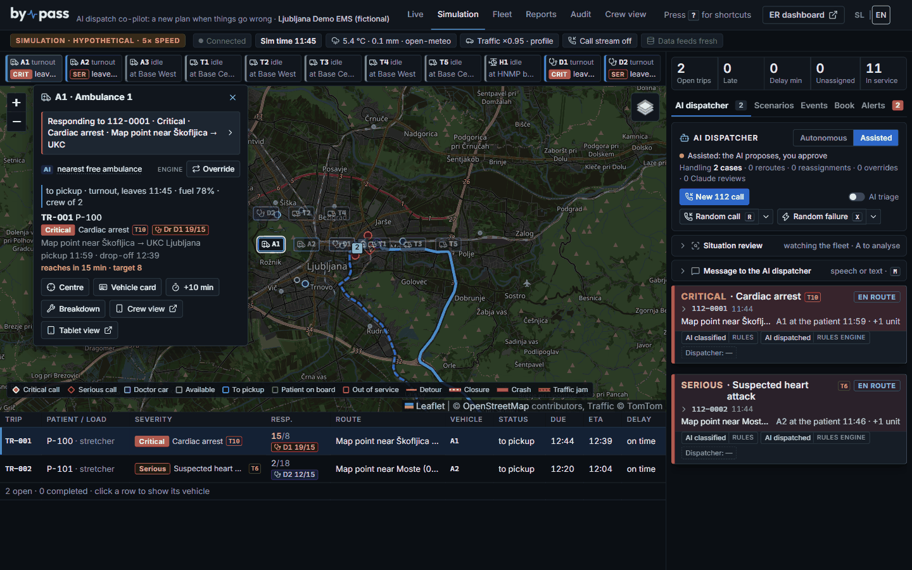
</p>

**Dispatcher dashboard: every call as a case.** From the 112 call to the end: severity and condition, the unit sent and its arrival time, who classified it (here the keyword rules, because this local capture had no Claude key; on the deployed app it is Claude), who dispatched it (rules engine), and a timeline of who did what (caller, AI or rules, engine, dispatcher, crew). Click a unit on the map for its popup with the reason it was sent and an **Override** button.

<p align="center">
  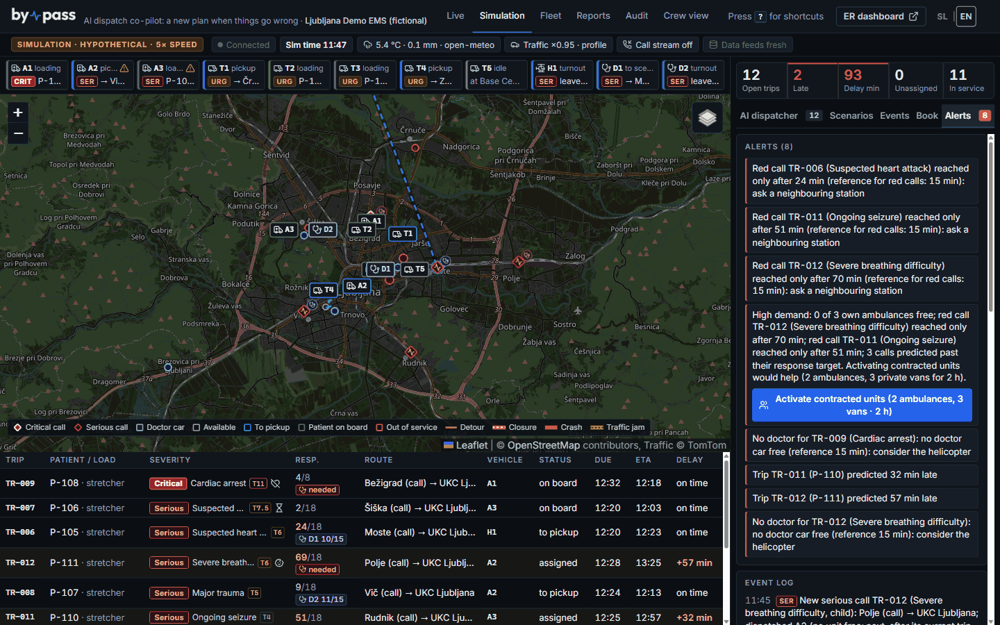
</p>

**Alerts under load.** After the Surge scenario: red calls predicted over the 15-minute reference ("ask a neighbouring station"), a high-demand alert with the button that activates contracted private units (the dispatcher's decision), "no doctor car free: consider the helicopter", and late trips. The event log with the clinical reason for each decision is below the alerts.

<p align="center">
  
</p>

**Vehicle popup.** Click any vehicle on the map or in the strip: what it is responding to, **why the AI dispatcher sent it** (here: "Dispatched A1, diverted from TR-006 (serious) to this critical call"), an **Override** button, fuel, crew, and links to the vehicle card, the crew view and the tablet view.

<table>
  <tr>
    <td width="42%" valign="top">
      
      <br><b>In-vehicle tablet.</b> Current job with the caller's words, alerts that touch this unit, next stops, map navigation (heading up, north up, overview), one-tap reports and a message to dispatch.
    </td>
    <td width="42%" valign="top">
      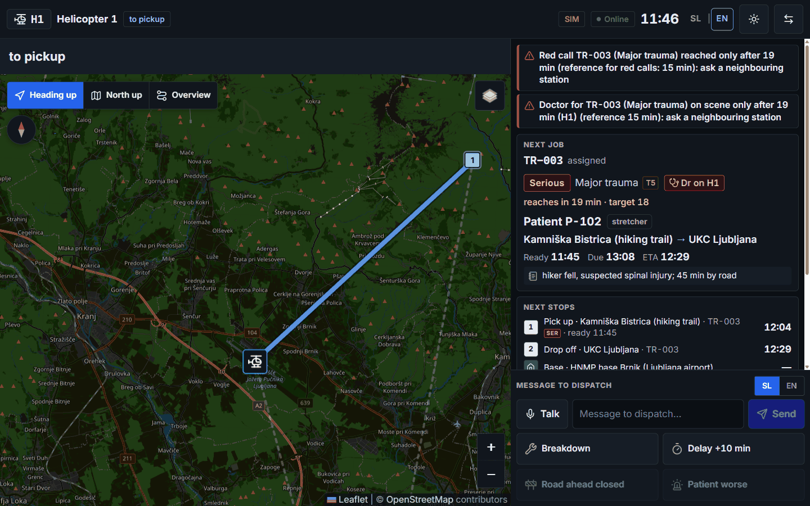
      <br><b>Helicopter H1.</b> Straight-line flight from the Brnik base to the patient (a hiker in the mountains) instead of road turns.
    </td>
    <td width="16%" valign="top">
      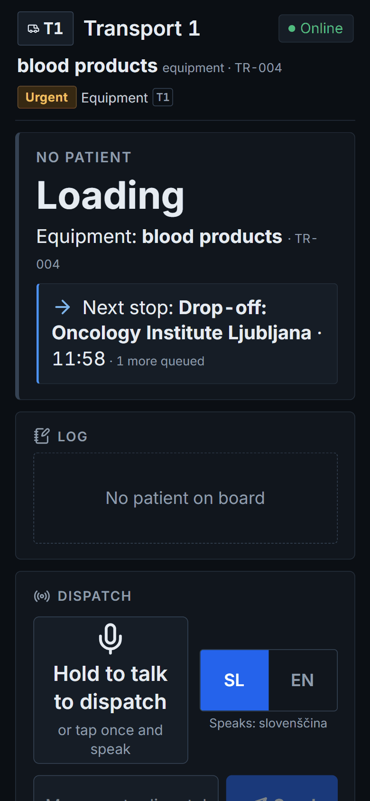
      <br><b>Crew phone.</b> The job, the next stop, hold to talk (SL/EN) or tap a quick report.
    </td>
  </tr>
</table>

<p align="center">
  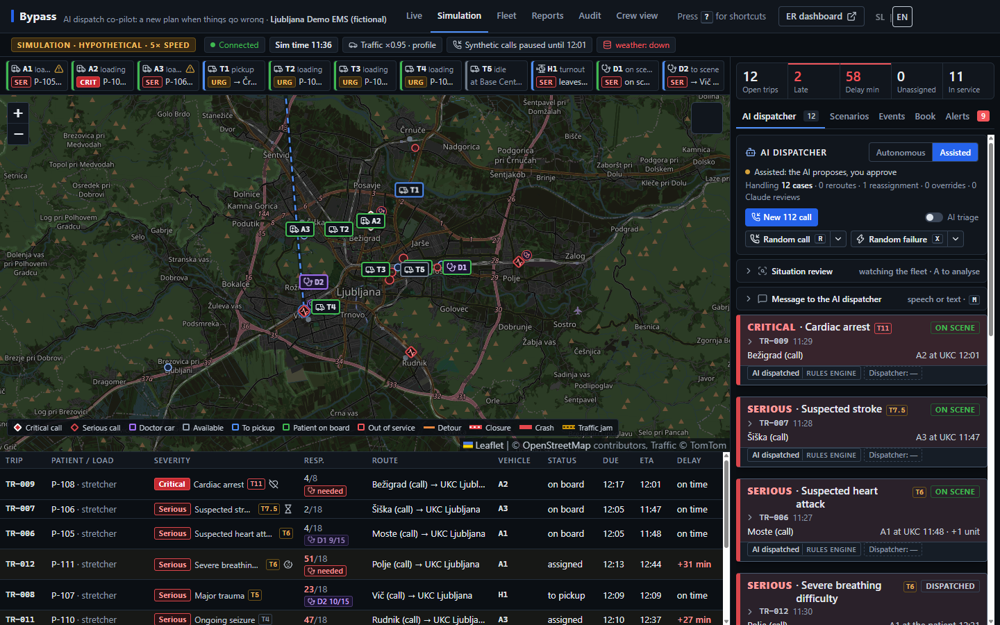
</p>

<p align="center">
  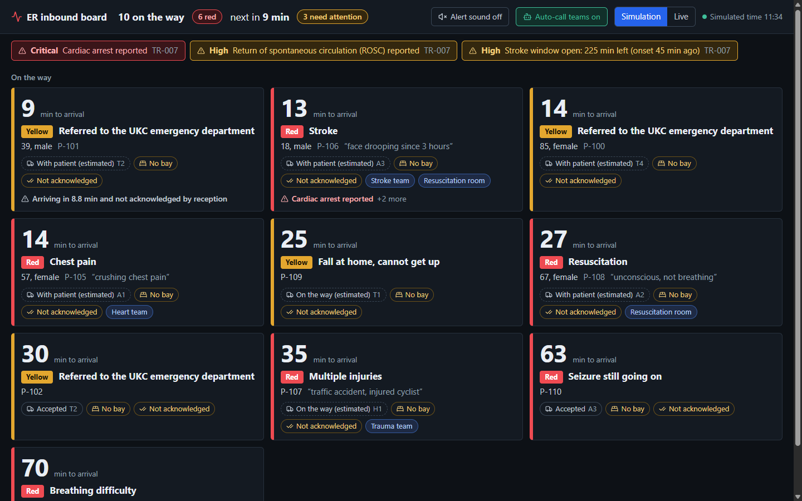
</p>

**ER inbound board.** For reception staff: who is on the way, how urgent, when they arrive, what the crew has done, what to prepare. Tiles are ordered by arrival time; the ribbon shows what needs attention now. Anything the system only estimates (level, stage) looks different from what a person recorded.

<p align="center">
  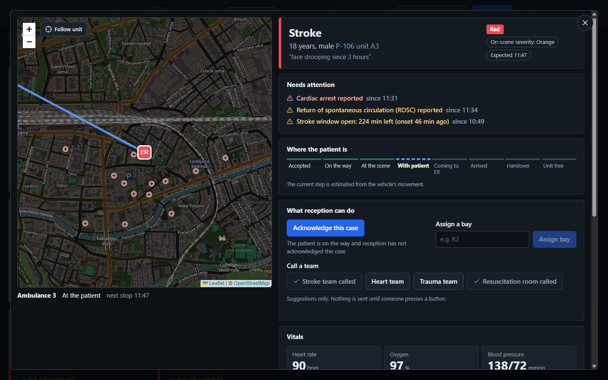
</p>

**One case in the ER board.** Live map of the ambulance (refreshed every 2 s), the alerts, the eight-step stage bar ("current step is estimated from the vehicle's movement"), the three reception actions, vitals with their age, treatments and the full timeline.

<p align="center">
  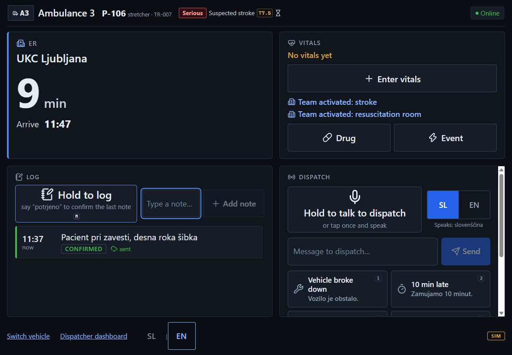
</p>

**Crew tablet (patient compartment).** For a paramedic with gloves on and hands busy: a large countdown to the ER, a voice and typed **log** (each line starts as *heard* and is *confirmed* with a tap or by saying "potrjeno"), tap pads for **vitals**, **drugs** and **events**, what the ER has done ("Team activated: stroke"), and the separate **dispatch** panel (hold to talk, quick reports 1–5). A handover screen with the 15-minute timer appears on arrival.

<p align="center">
  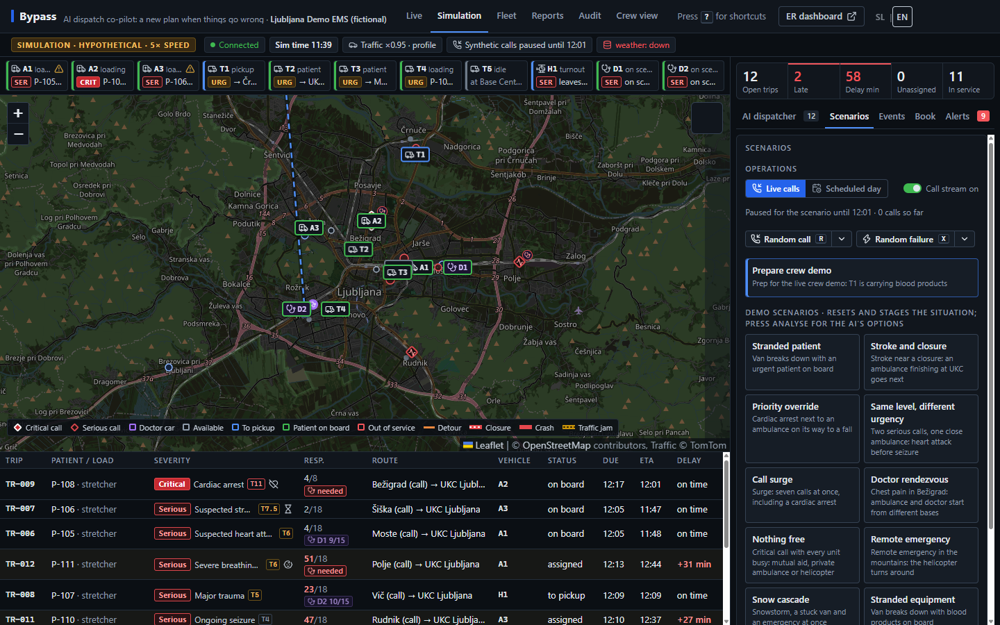
</p>

**Scenarios tab.** One-click stagings for the jury: surge, stranded patient, helicopter, snow cascade, hospital full and more. Each resets the world and shows what to look at (table in [DEMO.md](DEMO.md)).

<p align="center">
  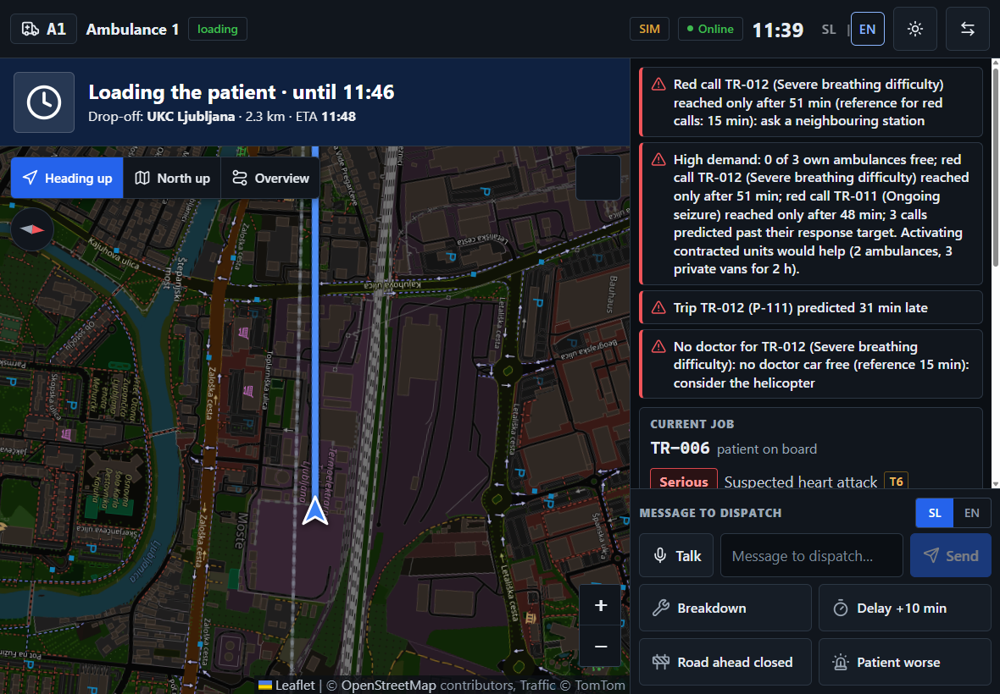
</p>

**Driver tablet.** The cab view: navigation, the job, alerts that touch this unit and one-tap messages to dispatch. The patient-compartment tablet above is a different screen on a different route.

Promo, ads and four recorded walkthrough videos of the real UI are generated from the scripts in [media/](media/README.md) (the rendered files are not in git).

---

## What it does

### Part 1 of the brief: the initial plan (*začetni plan*)

- **Fleet:** 3 emergency ambulances (A1–A3), 5 patient-transport vans (T1–T5), 1 helicopter (H1, based at Brnik, Ljubljana airport, like the real HNMP; it flies patients to UKC) and 2 doctor cars (D1, D2). Reserve units (a neighbouring station's ambulance M1, private ambulances P1 and P2, private vans) join only when the dispatcher requests them or activates surge capacity.
- **Tasks:** patient transport (seated, wheelchair, stretcher), equipment transport (blood products, defibrillator, lab samples, ventilator) and urgent runs (emergency and urgent calls).
- **Constraints modelled:** vehicle capabilities (a van never takes an emergency, the helicopter never carries equipment or routine trips, doctor cars never transport), ready-at and due-by time windows, task priorities (four severity levels), several trips per vehicle (a queue per vehicle), pickup and delivery, and hospital admission capacity.
- **Travel:** ambulances and vans on real road routes (OSRM, with TomTom as backup), adjusted for live traffic, weather and incidents; the helicopter in a straight line at **200 km/h**, after **13 minutes from the call to take-off** at its base (the HNMP average) and 2 to 3 minutes to land, **by day only** (new calls 08:00 to 16:30; at night it shows as unavailable): [docs/SERVICE_TIMES.md](docs/SERVICE_TIMES.md).
- **Scheduled-day mode** (the brief's initial plan): the vans start with a pre-planned day of 24 synthetic booked trips and 4 equipment runs, placed greedily and then improved by a local search. The default seed starts with no late and no unassigned trips. Switch to it in the Simulation world's Scenarios tab, or with `POST /sim/admin/reset {"scheduled_day": true}`.
- **Default mode is live calls:** there is no pre-planned day. Calls arrive about 5 per world-hour (`CALLS_PER_HOUR`; the Simulation world's clock runs 5× faster) and each is dispatched at once, which is closer to how emergency medical services work. The Live world's stream is on by default; the Simulation world's is off (`SIM_CALLS_ENABLED=0`): you start calls yourself or switch the stream on in the Scenarios tab.
- **Crew availability** is shown (fictional crews and shifts on vehicle cards) but is **not yet a planning constraint**.

### Part 2: plan repair (*popravek plana*)

Every event below goes through one engine, is applied to the world's state and re-projects every trip.

| Event in the brief | What Bypass does |
|---|---|
| Vehicle breakdown (*okvara vozila*) | The unit goes out of service and its jobs are released. A patient on board is collected at the roadside. **Equipment on board must first be collected by another vehicle at the breakdown site** (the brief's rule). 112 calls are re-dispatched at once; stranded equipment and bookings become a decision for the AI dispatcher and the dispatcher. |
| Fog (*megla*) | Helicopters are grounded for 1 hour. Trips not yet picked up go to road units at once; a flight with a patient on board finishes. Fog is reported or injected (crew message, dispatcher, hotkey); it is not detected from weather data. |
| Urgent new task (*nova nujna naloga*) | A 112 call or a map click is dispatched at once by the doctrine below; a booking is placed on the van where it fits best. |
| Reduced hospital capacity | Patients heading to a hospital that can admit fewer than are coming raise an alert. The most urgent keep their place; options redirect the rest to other general hospitals and state the cost. |
| Patient priority change | A level change re-evaluates dispatch. Raised to emergency on a van: the van loses it and an ambulance is sent. |
| Vehicle delays (*zamude*) | ETAs and knock-on delays are re-projected. After **every** disruption the engine recalculates each 112 call it touched and says so on the timeline, also when nothing changes: a free ambulance at least 3 minutes sooner takes over, also from a unit the dispatcher chose when the disruption pushed that unit back by 3 minutes or more. |
| Road closures (*zaprte ceste*) | Vehicles are routed around the closure (drawn along the blocked road on the map, like crashes and traffic jams; TomTom routing with avoid areas). Without the detour service the route is kept with a slowdown. |
| Shortage of vehicles (*pomanjkanje vozil*) | A high-demand alert and options: a neighbouring station's ambulance (M1), a private ambulance (P1), or contracted surge capacity, and an honest statement of who waits. |

### Part 3: the Slovenian AI assistant

A crew member speaks or types, for example *"Vozilo je obstalo. Oprema je še v njem."* ("The vehicle has stopped. The equipment is still inside."). Claude turns the message into typed, validated events (here: a breakdown of the sender's vehicle, equipment on board; the assumption is stated back in Slovenian and English), asks back when the message is ambiguous, and the engine applies the events. The AI dispatcher then proposes 2–3 simulated plans, one of them recommended, and the dispatcher approves with one key. See [How the AI is used](#how-the-ai-is-used).

### Main features

- **AI dispatcher tab** (the dashboard's first tab). Every call is a case card: the caller's words in Slovenian and English, who classified it (Claude, keyword rules or the dispatcher), the unit that was sent with **a one-line reason per unit** ("nearest free ambulance", "available soon: finishes at UKC, 12 min sooner than A2", "doctor needed for cardiac arrest: first doctor car on scene"; the arrival time next to it is the live one) and **who decided each step**, and a timeline. A switch sets the mode: **Autonomous** (Claude's recommendation is applied after the engine re-checks it) or **Assisted** (the default: a proposal to approve). **Override** lists every other unit ranked by the engine with its arrival time and cost ("free", "diverts TR-003, which then waits 12 min longer", "private ambulance"), and **Add unit** adds a doctor car, a further ambulance or the helicopter. A unit the dispatcher chose by hand sticks: the AI does not change it, and the engine does not divert it to a higher-level call (it says so: "A1 not diverted: assigned by the dispatcher to TR-003 (Override to divert)"). The one exception is a disruption that holds that unit up by 3 minutes or more: a free ambulance at least 3 minutes sooner then takes over, and the timeline says "A1 was the dispatcher's choice but is held up". Details: [docs/DISPATCH_PRIORITIES.md](docs/DISPATCH_PRIORITIES.md) section 8.
- **Live calls and 112 intake.** A call-taker types or dictates the call (address, known place or map point). Claude triages it into a severity, a condition, case modifiers, a doctor flag and a one-sentence clinical reason; keyword rules take over when Claude is off, limited or slow. The call then follows the normal dispatch path and gets a timeline.
- **Severity levels and dispatch doctrine.** Critical, serious, urgent, routine, with 14 conditions weighted by time sensitivity (cardiac arrest 10, stroke and heart attack 6, ...) and response targets (critical 8 min in the city / 15 outside, serious 18, urgent 60). The engine sends the closest suitable unit by true arrival time (including one finishing a drop-off nearby), may divert a unit from a lower-level call when the saving is clear, evaluates the helicopter for every red call, and judges stroke and heart attack by arrival at UKC. A red call predicted over 15 minutes raises an alert. Rules and sources: [docs/DISPATCH_PRIORITIES.md](docs/DISPATCH_PRIORITIES.md).
- **Doctor cars.** For red calls that need a doctor, a doctor car (VUZ: physician and nurse) joins the ambulance crew on scene; the helicopter carries a doctor.
- **Surge capacity.** A demand alert (with hysteresis) offers contracted private ambulances and vans for 2 hours. Activation is always the dispatcher's decision.
- **Detours around closures,** including the loaded leg of a stroke patient.
- **Helicopter H1** as the real service runs it: based at Brnik, 13 minutes from the call to take-off, 08:00–16:30 only (greyed out with "Unavailable at night until 08:00" otherwise), straight-line flight, fog grounding. In practice it serves remote calls, and city calls only when every ambulance is busy.
- **Reports** (`/reports`): operational statistics per world over the last 1, 3 or 8 world-hours: response time against the target by severity, calls within target, doctor on scene within 15 minutes, late transports, unit utilisation, and who decided (rules engine, Claude, dispatcher override). `GET /{world}/reports`.
- **Slovenian and English everywhere.** A switch in every header. The dashboard defaults to English, the crew phone and the tablet to Slovenian; `?lang=sl` or `?lang=en` in the address sets it for that device.
- **Demo lock (optional).** With `ADMIN_KEY` set, only devices that carry the key (opened once with `?key=`) can reset, inject, approve, override or spend AI tokens; everyone else sees a read-only dashboard. **The deployed backend currently runs without a key: the app is open to everyone and no lock chip is shown.** A shared demo key, not a login: [docs/RELIABILITY_AND_SECURITY.md](docs/RELIABILITY_AND_SECURITY.md).
- **In-vehicle tablet** (`/vehicle/:id`): turn-by-turn navigation, current job, next stops, one-tap reports without AI, and messages from dispatch when the plan changes.
- **Crew tablet and phone** (`/crew/:id`): push-to-talk in Slovenian or English (browser speech recognition), typed text, quick reports 1–5. The same page also carries the patient-compartment clinical log: tap pads for vitals, drugs and events, timers, the ETA to the ER and a 15-minute handover screen (design: [docs/superpowers/specs/2026-11-21-crew-patient-tablet-design.md](docs/superpowers/specs/2026-11-21-crew-patient-tablet-design.md)).
- **ER inbound board** (`er-dashboard/`, served by the frontend at `/er/`): a separate screen for ER reception. One tile per patient on the way, ordered by arrival time, with the crew's clinical log, alerts, and reception actions (acknowledge, assign a bay, call a team). It reads the backend's `clinical` module (`GET /{world}/er/board`); data contract: [docs/superpowers/specs/2026-11-22-er-dashboard-api-contract.md](docs/superpowers/specs/2026-11-22-er-dashboard-api-contract.md), details: [er-dashboard/README.md](er-dashboard/README.md). All patient data is synthetic.
- **Audit log:** every event, 112 call, crew message, interpreted event, AI recommendation, dispatcher decision and override, stored in PostgreSQL (memory only without `DATABASE_URL`), filterable on the Audit page and exportable as JSON lines.
- **Live and Simulation worlds** (below), a status bar showing each data source as fresh, stale or down, a switchable base map and TomTom traffic layer, and keyboard shortcuts (press `?`).
- **Demo tools (Simulation only):** 12 one-click scenarios; **Random call** (`R`); **`E` + a click on the map**, which creates a real 112 call from the call library (picked condition and level) at that point; **Random failure** (`X`: crash, closure, traffic jam, fog, breakdown, delay, hospital capacity, equipment) and **Choose unit…** to aim a failure at one unit; a call-stream switch; an AI-triage switch.

**Live vs Simulation.** Both worlds share the real weather, traffic and incident feeds. **Live** runs on the real clock and accepts only real operator reports. **Simulation** is the presentation sandbox: a 5× clock, hypothetical weather such as a snowstorm, demo scenarios and reset. In both, the fleet and the calls are generated by the simulator, which stands in for the vehicle GPS feed and the call centre.

## The screens and how they connect

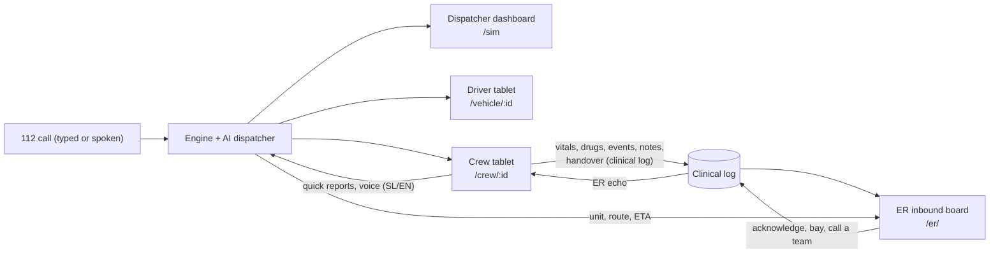

- **One truth.** Dispatch, driver tablet, crew tablet and ER board read the same world state. An ambulance's ETA is computed once, by the engine, and every screen shows that number.
- **Two voice channels that never mix.** On the crew tablet, *Hold to log* writes a clinical note word for word and is **never** sent to the dispatch parser. *Hold to talk to dispatch* goes to Claude, which turns it into a typed event (breakdown, delay, ...). Clinical words like "nezavesten" must not start a new emergency.
- **Honest data.** A value is stored exactly as entered. A vital sign always shows its age. An implausible value is shown and flagged **check this**, never silently corrected. Anything estimated is marked as estimated.
- **A person decides.** The ER board only *suggests* teams; nothing is sent until someone presses a button (one exception: **Auto-call teams**, see below).

## ER inbound board (`/er/`)

*Who is it for:* reception staff at the emergency department of UKC Ljubljana (the only ER in the demo). It shows only what reception needs: no fleet map, fuel, crews or traffic.

- **Case grid:** one tile per patient bound for the ER, ordered by minutes to arrival, then arrived patients. A tile shows level (red/yellow), problem, age and sex, assigned unit and stage, bay, acknowledgement, suggested and called teams and the top alert.
- **Alert ribbon and sound:** critical (cardiac arrest) and high (heart attack, airway, open stroke window, vitals out of limits, unacknowledged arrival, no vitals on a red case) alerts. A sound plays for new alerts once you switch **Alert sound** on (browsers require a click first).
- **Case popup** (click a tile; `Esc` closes): live map, stage bar, alerts, vitals with age, treatments, key events, timeline, and the three reception actions: **Acknowledge**, **Assign a bay**, **Call a team** (stroke, heart, trauma, resuscitation room).
- **Auto-call teams** (header switch, on by default): calls the teams the backend suggests for each case, by a fixed rule table, noted as "Called automatically: …". It is rules, not an AI model, and it never calls the same team twice, even with several screens open.
- **Simulation / Live switch** and `#TR-007` in the address opens that case.
- Thresholds (minutes unacknowledged, minutes without vitals, stroke window) are **placeholders** set in `backend/app/clinical/config.py`; real ER staff would set them.

**How to test it**

| Do this | You should see |
|---|---|
| Dispatcher → Scenarios → **Surge** | Several tiles appear on the ER board within seconds, ordered by ETA; a unit id on each tile |
| Click a tile | Popup with a live map; the ambulance moves |
| Press **Acknowledge** | "Acknowledged" on the tile; the crew tablet of that unit shows it |
| **Assign a bay** `R2` | Bay on the tile and on the crew tablet |
| **Call a team** | Team chip; "Team activated: …" on the crew tablet |
| Switch **Alert sound** on, run `crew_sim` | A siren on a cardiac arrest, two chimes for a high alert |
| Leave a case unacknowledged | An alert "Arriving in N min and not acknowledged by reception" |
| Dispatcher → **Random failure → Engine failure** | The case's unit changes and its ETA on the ER tile moves |

## Crew tablet (`/crew/:vehicleId?world=sim`)

*Who is it for:* the paramedic in the patient compartment, on a tablet (it also collapses to one column on a phone). The driver's navigation tablet stays at `/vehicle/:id`.

- **ETA first:** a big countdown to the ER with arrival time, hospital name and a late marker.
- **Log (voice or typed):** push-to-talk in Slovenian puts each utterance on a timeline as *heard*; one tap, or saying **"potrjeno"**, makes it *confirmed*. Spoken lines are saved word for word and are **not** turned into drugs or numbers.
- **Tap pads for loud moments:** **Enter vitals** (heart rate, blood pressure, SpO₂, breathing rate, GCS, temperature, glucose), **Drug** (drug, dose, route), **Event** (cardiac arrest, CPR started, ROSC, defibrillation, airway secured, stroke onset, STEMI, transfusion started, patient worse). Entries are sent to the ER at once and queued if the signal drops (a *sent / not sent* mark).
- **Vitals age:** "last vitals N min ago", amber when overdue.
- **ER echo:** what the ER did ("ER has acknowledged", "Bay R2", "Team activated: stroke") is shown on the tablet.
- **Handover screen** on arrival: the record to read out and a **15 minute** timer; **Handover done** moves the ER card to *predaja pacienta* and stops its timer.
- **Dispatch panel** (unchanged): hold to talk (SL/EN) or quick reports 1–5. The demo script uses it.
- Slovenian and English; works for ambulances. A doctor car's entries are refused by the backend (shown as not accepted).

**How to test it**

| Do this | You should see |
|---|---|
| Open `/crew/A3?world=sim` for a unit that has a patient (a unit id is on its ER tile) | Job header, ETA to UKC, vitals panel |
| Type a note and press **Add note** | A *confirmed · sent* line; the same text in that case's ER popup timeline |
| **Enter vitals**, enter values, save | Vitals with "just now" on the tablet and on the ER tile; implausible values show **check this** |
| **Drug** → drug, dose, route | A treatment on both screens |
| **Event → Cardiac arrest** | A critical alert on the ER ribbon (and a siren if sound is on) |
| On the ER board press **Acknowledge** | "ER has acknowledged" on the tablet within a few seconds |
| **Vehicle broke down** (dispatch panel, or key `1`) | The dispatcher sees the event and re-plans; the ETA on the tablet and ER tile changes |
| When the unit arrives: the handover screen, then **Handover done** | ER tile moves to *predaja pacienta* and its timer stops |

Speech needs Chrome or Edge, HTTPS and a microphone permission. Without it, type or tap: nothing depends on speech.

## Cross-screen test flows

1. **112 call to hospital, all screens.** Dispatcher → **New 112 call**: *"Mož se je zgrudil na dvorišču, ne diha."* at *Šmarska cesta 3, Škofljica* → case card and unit on the dispatcher → job on the driver tablet and the crew tablet → tile on the ER board.
2. **Crew to ER.** Crew tablet → vitals, drug, event → ER popup updates, alerts fire.
3. **ER to crew.** ER popup → Acknowledge, bay, team → crew tablet shows the echo.
4. **Disruption.** Dispatcher → Random failure (engine failure) → re-plan box and Claude's review → driver and crew tablets get the new plan → ER tile shows the new unit and ETA.
5. **Handover.** Let a unit arrive → crew tablet handover with 15 min timer → *Handover done* → ER tile moves on.
6. **Everything is logged.** `/audit` lists calls, AI recommendations, dispatcher decisions and overrides; ER actions and crew entries are in the clinical log (`GET /sim/clinical/entries`).

---

## How the AI is used

**Claude (Sonnet 5.5, `claude-sonnet-5-5` by default) does four things:**

1. **Understands crew messages** in Slovenian or English and turns them into typed events (breakdown, delay, closure, urgent request, fog, priority change, hospital capacity, booking). It may only use vehicle, place and trip IDs from the current situation, and asks back instead of guessing.
2. **Triages 112 calls** from the caller's words (structured output). A safety net lets red-flag keywords raise Claude's level, never lower it.
3. **Is the AI dispatcher of each case.** The engine has already dispatched the call. Claude then reviews every new critical or serious call and every disruption of an open call (breakdown, delay, a closure on the unit's route, a priority change), with three engine-backed tools (`find_candidates`, `simulate_plan`, `get_vehicle_schedule`). It either keeps the engine's decision (and says why) or recommends a better option. In **Autonomous** mode that option is applied through the dispatcher's own approval path: the engine re-simulates and re-checks it, refuses it with a reason if it is infeasible or the situation changed, and the timeline says "AI dispatcher (Claude) changed: …". In **Assisted** mode (the default) the reviews run when Auto-analyse is on and stay proposals.
4. **Reviews the whole situation on request** ("Situation review", hotkey `A`, or automatically with Auto-analyse on): 2–3 options with a recommendation, a clinical reason for each, and notification drafts in Slovenian and English, for disruptions that are not a 112 call (equipment, bookings, hospital capacity, fog, several problems at once).

**What Claude does not do:**

- **It computes no numbers.** Every ETA, delay and late-trip count comes from the deterministic engine. Each option is re-simulated by the engine before the dispatcher sees it.
- **It changes nothing directly.** The AI has read-only tools and a what-if simulator. Applying an option replays exactly the steps that were shown, re-checks them against the current situation, and is refused with the reason if the situation has changed for the worse.
- **It does not override the dispatcher.** A unit the dispatcher assigned by hand is not changed by the AI, and by the engine's follow-up only when a disruption holds that unit up by 3 minutes or more and a free ambulance is at least 3 minutes sooner. The dispatcher approves (`Y`) or rejects (`N`) proposals, and can replace any unit at any time. The engine itself acts without asking only at the moment of dispatch (closest unit, a clearly justified override, the helicopter) and in the automatic follow-up of 112 calls (re-dispatch when a unit drops out, a recalculation after every disruption, a free unit at least 3 minutes sooner, a missing doctor car). Trade-offs such as swaps between same-level calls, reserve units, contracted surge capacity, and the plans for non-call work stay with the dispatcher, in either mode.

**When Claude is unavailable** (no key, error, refusal, timeout, or usage limit):

| Function | Fallback |
|---|---|
| AI dispatcher review of a case | The engine's decision, which was already applied, stands; the case timeline says why there was no review. |
| Situation review | The engine's own greedy plan, fully simulated, shown with a note ("Engine only"). The whole analysis has a 60 s deadline (`AGENT_TIMEOUT_S`). A refusal may be retried on Anthropic's server-side fallback model first. |
| 112 call triage | Keyword rules (Slovenian and English stems) after 12 s. A call is never lost. |
| Crew message parsing | The message is refused with a clear error; the crew phone's quick reports fall back to the equivalent direct event, and the dispatcher has event buttons. |

**Usage guard** (`backend/app/guard.py`): at most 12 Claude requests per rolling 5 minutes and 300 per UTC day by default, shared by both worlds and by every path (analyses, case reviews, crew messages, 112 triage). Over the limit, automatic analyses and reviews are skipped, triage uses the keyword rules, and crew messages get HTTP 429 with a Slovenian and English explanation. Auto-analyse is off by default; a routine call never starts a general analysis; analyses started by a call problem or a high-demand alert are limited to one per 15 world-minutes. Counts are in memory and reset on restart.

**Data:** no real patient data; patients are labels (P-123). **Not everything sent to Claude is anonymous**: the 112 triage request is the caller's words and the typed address, a case's analysis carries the address and the caller's words as the case note, and a crew message carries its text. The caller's name, crew names and the audit log are never sent. Chrome's speech recognition sends audio to Google. All data in the prototype is synthetic. A production deployment would use an EU region, a processing agreement, zero retention, redaction and on-premises speech recognition: [docs/RELIABILITY_AND_SECURITY.md](docs/RELIABILITY_AND_SECURITY.md) section 2.

---

## Architecture

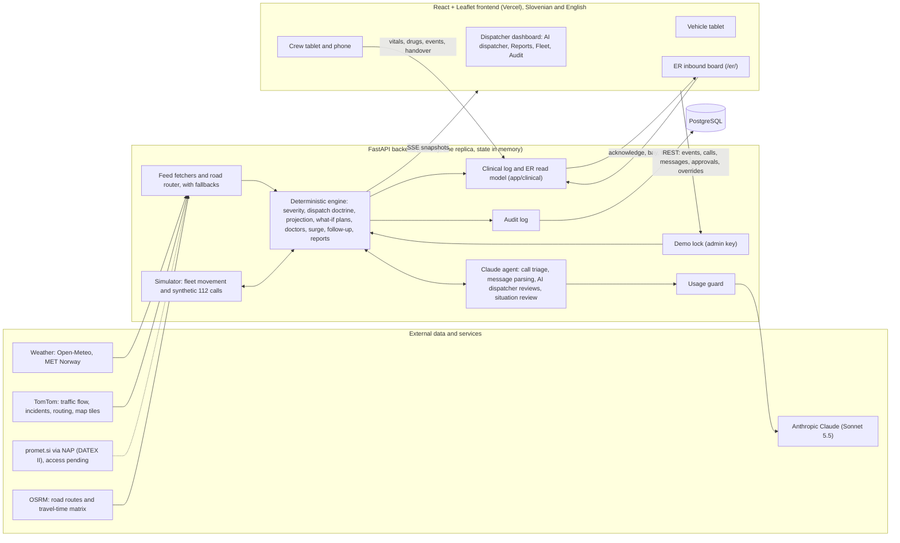

- **Nothing waits on a network call.** Decisions use cached data; feeds refresh in the background on fixed intervals, and a cache miss falls back to an estimate at once. The simulator ticks every 2 seconds.
- **One engine, two worlds.** The engine (`backend/app/engine/`) holds every rule and number. The simulator moves vehicles and generates calls; the Claude agent (`backend/app/agent/`) and the AI dispatcher (`backend/app/ai_dispatcher.py`) only propose or apply through the engine's checked path.
- **Live updates** reach all three views as server-sent events (`GET /{world}/stream`); actions are plain REST calls, and with `ADMIN_KEY` set each needs the `X-Plan-B-Key` header (reading never does).
- **Hosting.** Backend on **Railway** (root directory `backend`, `python -m app`, health check `/health`, one replica because the state lives in memory) with a **PostgreSQL** database for the audit log. Frontend on **Vercel** (root directory `frontend`, Vite build). TomTom map tiles are proxied through the backend so API keys never reach the browser.

---

## Data sources and fallbacks

Every input has a second source and every step has a fallback, and the status bar shows which one is in use. This is what the prototype already does ([docs/RELIABILITY_AND_SECURITY.md](docs/RELIABILITY_AND_SECURITY.md)):

| What | Primary | Backup | If everything fails |
|---|---|---|---|
| Weather | Open-Meteo | MET Norway | Last known value, marked stale |
| Traffic speed | TomTom Traffic Flow | promet.si / NAP (client built, access pending) | Time-of-day profile for Ljubljana |
| Incidents and closures | TomTom Incident Details | promet.si / NAP road events | Reports from crews and the dispatcher |
| Road routes | OSRM | TomTom Routing | Straight-line distance × 1.35 |
| Detours around closures | TomTom Routing with avoid areas | none | Route kept, closure slowdown applied |
| Travel-time matrix | OSRM table | Cached road routes | Straight-line estimate |
| AI recommendation | Claude Sonnet 5.5 | Anthropic server-side fallback model | Deterministic engine plan |
| 112 call triage | Claude | Keyword rules | A call is never lost |
| Audit log | PostgreSQL | In-memory buffer, retried with backoff | Never blocks a dispatch action |
| Crew input | Speech (Web Speech API, SL/EN) | Typed text | Quick reports 1–5 |

TomTom quotas are protected by daily caps; when one is reached the backup takes over and says so. A note in the code says Open-Meteo is unreachable from Railway's network; MET Norway then serves as the weather source.

### Research basis

The dispatch rules are a model built from published practice, not medical advice and not measured Ljubljana data.

- [docs/DISPATCH_PRIORITIES.md](docs/DISPATCH_PRIORITIES.md): severity levels (SloIn NMP, UK Ambulance Response Programme, MPDS), time sensitivity per condition, override and helicopter rules, doctor cars, surge capacity, 112-call lifecycle, the AI dispatcher modes, with sources.
- [docs/SERVICE_TIMES.md](docs/SERVICE_TIMES.md): turnout, on-scene, handover and cleaning times, and the helicopter's base, activation and hours, each with its source or marked as an assumption.
- [docs/BENCHMARK.md](docs/BENCHMARK.md): the dispatch benchmark below.
- Slovenian EMS research by our teammate Metelko: [EMS_RESEARCH.md](docs/EMS_RESEARCH.md), [LJUBLJANA_FLEET_AND_TEAMS.md](docs/LJUBLJANA_FLEET_AND_TEAMS.md), [AGENTIC_DISPATCH_DESIGN.md](docs/AGENTIC_DISPATCH_DESIGN.md), [DISPATCH_SCENARIOS.md](docs/DISPATCH_SCENARIOS.md), [SURGE_AND_MULTI_SERVICE_COORDINATION.md](docs/SURGE_AND_MULTI_SERVICE_COORDINATION.md), [DATA_FRESHNESS.md](docs/DATA_FRESHNESS.md). Some figures come from news summaries or could not be checked against the 2026 rulebook; each document tags its confidence.
- Live-data probes: [docs/DATA_SOURCES.md](docs/DATA_SOURCES.md).

### Benchmark: Bypass's rules against nearest-free-ambulance dispatch

Same simulated calls for both policies, 100 seeds × 8 world-hours (day shifts, 08:00 to 16:00), normal load (5 calls per hour); reproduce with `cd backend && python tools/benchmark.py`.

| Metric | Nearest free ambulance | Bypass rules |
|---|---:|---:|
| Critical calls reached within target (8 min city / 15 outside) | 34.3 % | 53.8 % |
| Critical: median time to the patient | 12.4 min | 8.0 min |
| Serious calls reached within 18 min | 43.1 % | 64.4 % |
| Doctor on scene within 15 min (calls that need one) | 46.4 % | 52.0 % |
| Late transports | 20.5 % | 7.5 % |

**Read the caveats before quoting this.** It is a simulation with a synthetic call mix, a small demo fleet (3 ambulances, 1 helicopter) and straight-line travel; the baseline is a plain "nearest free ambulance" rule, not today's dispatchers; the AI is not in the loop. The helicopter is modelled as the real service runs it: based at Brnik, 13 minutes from the call to take-off, by day only, so it goes to remote and suburban calls and to city calls only when every ambulance is busy (17 % of red calls). With ground units only, critical calls within target improve from 34.3 % to 42.6 %, serious calls within 18 min barely move (43.1 % to 45.5 %), and the slowest tenth of serious calls waits about 7 minutes longer, which is the trade-off the doctrine chooses (higher level first). An earlier run with an unrealistic helicopter (at UKC, any hour, 3 minutes overhead) showed 74 % against 35.5 %; we no longer quote it. Full tables and limits: [docs/BENCHMARK.md](docs/BENCHMARK.md).

---

## Run it

### Backend (Python 3.12)

```bash
cd backend
uv venv --python 3.12 .venv
uv pip install --python .venv/Scripts/python.exe -r requirements.txt   # macOS/Linux: .venv/bin/python
.venv/Scripts/python.exe -m app                                         # http://localhost:8000/docs
```

Everything runs without any key: without `ANTHROPIC_API_KEY` the engine's own plan is shown, 112 calls are triaged by keyword rules and crew messages cannot be parsed; without `TOMTOM_API_KEY` traffic comes from a time-of-day profile and there are no detours. Settings are environment variables (names only here; every one is listed with a one-line comment in [backend/.env.example](backend/.env.example), and see [backend/README.md](backend/README.md)):

| Variable | Purpose |
|---|---|
| `ANTHROPIC_API_KEY` | Enables Claude (triage, message parsing, AI dispatcher) |
| `TOMTOM_API_KEY` | Live traffic flow, incidents, backup routing, detours, traffic tiles |
| `NAP_USERNAME`, `NAP_PASSWORD`, `NAP_DATASETS` | promet.si events via the National Access Point (dataset permissions must be approved first) |
| `ADMIN_KEY` | Demo lock: with it set, every POST/PUT/PATCH/DELETE needs the header `X-Plan-B-Key`; reading stays open. Empty or unset = no lock |
| `DATABASE_URL` | PostgreSQL for the audit log (on Railway a reference to the Postgres service; read by `app/audit.py`; without it the log is memory-only) |
| `AGENT_MODEL`, `AGENT_EFFORT`, `AGENT_AUTO`, `AGENT_MAX_TURNS`, `AGENT_TIMEOUT_S` | Model, reasoning effort, auto-analyse default, tool turns per analysis, analysis deadline |
| `CLAUDE_MAX_PER_5MIN`, `CLAUDE_WINDOW_S`, `CLAUDE_MAX_PER_DAY` | Usage guard limits |
| `SIM_SPEEDUP`, `LIVE_SPEEDUP`, `CALLS_PER_HOUR`, `CALLS_ENABLED` (Live), `SIM_CALLS_ENABLED` (Simulation, off by default), `SCHEDULED_DAY`, `RANDOM_SEED` | Simulation clock, call stream and start mode |
| `ROAD_ROUTING`, `OSRM_URL` | Turn road routing off, or point at your own OSRM server |
| `TOMTOM_*_CAP`, `*_INTERVAL_S`, `AUDIT_TABLE`, `HTTP_USER_AGENT`, `PORT` | Daily API caps, fetch intervals and a few deployment details |
| `CLINICAL_ENABLED` | Kill switch for the clinical log and the ER board (default on; `0` turns the ER routes off) |

### Frontend (Node)

```bash
cd frontend
npm install
npm run dev                                       # uses the deployed Railway backend by default
VITE_API_URL=http://localhost:8000 npm run dev    # or a local backend (PowerShell: $env:VITE_API_URL="http://localhost:8000"; npm run dev)
npm run typecheck
npm run build
```

Routes: `/live`, `/sim` (the dashboards), `/fleet?world=sim`, `/reports?world=sim&hours=3`, `/audit`, `/crew/A3?world=sim` (crew tablet, also fits a phone), `/vehicle/A1?world=sim` (driver tablet), `/er/` (the ER inbound board, built into this frontend; to run it on its own: `cd er-dashboard && npm install && VITE_API_URL=http://localhost:8000 npm run dev`, port 5174; fill it with demo clinical data using `python backend/tools/crew_sim.py --world sim`). Add `?lang=sl` or `?lang=en` to set a device's language and, with a locked backend, `?key=<ADMIN_KEY>` once per device (the page keeps the key and removes it from the address bar). Voice input needs Chrome or Edge on an HTTPS page (or localhost) and microphone permission.

### Tests

Each backend test file runs offline (road routing off, no real Claude; a fake client stands in where the AI is tested). Most are standalone scripts; three (`test_clinical_models.py`, `test_clinical_service.py`, `test_clinical_store.py`) are pytest modules. Run them from `backend/`:

```bash
python tests/test_dispatch_rules.py
python -m pytest -q tests/test_clinical_store.py              # a pytest module (needs `pip install pytest`)
```

They cover dispatch rules, emergency dispatch, doctor cars, surge capacity, service times, the helicopter, plan execution, ops events (capacity, priority, fog), live calls, the 112-call lifecycle, the AI dispatcher, reports, the admin-key lock, navigation, road snapping, tiles, the Claude guard, the message schema, and the clinical log and ER board (27 test files, 373 test functions). The crew screen's pure logic has 125 more tests in `frontend/tests/crew/` (`cd frontend && node --test tests/crew/*.test.ts`, Node 24).

**CI:** every push to `main` (and every pull request to `main`) runs all backend test files (scripts, and pytest for the pytest modules), the frontend typecheck, a CSS brace check and the frontend build in GitHub Actions ([.github/workflows/ci.yml](.github/workflows/ci.yml)); the badge at the top shows the latest result. CI uses no API keys, so it exercises the engine fallback paths. It does not run the `frontend/tests/crew` tests or build `er-dashboard/`.

### Deployed setup

- **Backend:** Railway service from `backend/` (one replica) plus a Railway PostgreSQL database; start command `python -m app`; `GET /health` reports feed freshness, both worlds' clocks, TomTom usage, the audit log's database status, whether the demo lock is configured (`admin_lock`) and the Claude guard. Interactive API docs at `/docs`.
- **Frontend:** Vercel project from `frontend/`; `VITE_API_URL` points at the backend (it defaults to the Railway production URL). `vercel.json` rewrites every path to `index.html`.
- A push to `main` redeploys and restarts the backend, which resets the simulation, the usage counters, the AI mode and the other switches (the audit log in PostgreSQL survives).
- **Backup for a live presentation:** the recorded walkthrough videos, see [media/README.md](media/README.md) and [DEMO.md](DEMO.md).

---

## Repository layout

```
.
├── README.md
├── DEMO.md                  3-minute demo script, setup checklist, fallbacks, scenario guide
├── backend/                 FastAPI service
│   ├── app/
│   │   ├── main.py          API, SSE stream, background loops
│   │   ├── engine/          deterministic engine: severity, dispatch, projection, plans (what-if),
│   │   │                    doctors, surge, follow-up, timeline, unit reasons, service times, events
│   │   ├── agent/           Claude: situation review and AI dispatcher reviews (runner, prompts, context),
│   │   │                    112 triage, message parsing
│   │   ├── sim/             simulator, seed fleet and places, call generator, demo incidents
│   │   ├── fetchers/        weather, TomTom, NAP (promet.si)
│   │   ├── ai_dispatcher.py, overrides.py    Autonomous/Assisted reviews; alternatives and manual assignment
│   │   ├── reports.py       statistics for the Reports page
│   │   ├── hems.py          the helicopter service: Brnik base, 13 min activation, 08:00-16:30
│   │   ├── admin_key.py     the demo lock (X-Plan-B-Key)
│   │   ├── roads.py, routing.py, navigation.py   road routes, travel-time model, tablet navigation
│   │   ├── guard.py, audit.py, approvals.py, intake.py, demo.py
│   ├── app/clinical/        clinical log and ER board (crew entries, alerts, reception actions)
│   ├── tests/               test scripts and pytest modules (27 files)
│   └── tools/               dispatch benchmark and its results, crew_sim.py (demo clinical data)
├── frontend/                React, TypeScript, Vite, Leaflet
│   ├── src/                 dashboard (AI dispatcher tab, panels), pages (fleet, reports, audit, crew, tablet),
│   │                        i18n.ts and locales/ (Slovenian and English)
│   └── public/er/           built copy of er-dashboard, served at /er/
├── er-dashboard/            ER inbound board (React, Vite); `npm run build:embed` writes it to frontend/public/er
├── media/                   promo, ads and showcase-video scripts (renders go to media/out/, not in git)
├── docs/                    doctrine, research, benchmark, brief, pitch notes (images/, diagrams/, map/, scenario/)
├── .github/workflows/       CI
└── research/                throwaway API probes (not production code)
```

---

## Documentation index

| Document | What it is |
|---|---|
| [DEMO.md](DEMO.md) | The 3-minute demo script, setup checklist, fallbacks and scenario table |
| [docs/PITCH_NOTES.md](docs/PITCH_NOTES.md) | The five talking points with their numbers, and the five hardest questions |
| [docs/CHALLENGE.md](docs/CHALLENGE.md) | The Epilog brief with glossary |
| [docs/JURY_QA.md](docs/JURY_QA.md) | Likely jury questions with prepared answers |
| [docs/BUSINESS_ONE_PAGER.md](docs/BUSINESS_ONE_PAGER.md) | Business one-pager |
| [docs/DISPATCH_PRIORITIES.md](docs/DISPATCH_PRIORITIES.md) | Severity levels, dispatch rules, doctor cars, surge, 112 calls, AI dispatcher modes, sources |
| [docs/SERVICE_TIMES.md](docs/SERVICE_TIMES.md) | Turnout, on-scene, handover, cleaning times, the helicopter, and sources |
| [docs/BENCHMARK.md](docs/BENCHMARK.md) | Benchmark against nearest-free dispatch, with limits |
| [docs/RELIABILITY_AND_SECURITY.md](docs/RELIABILITY_AND_SECURITY.md) | Fallbacks, what data leaves the system, prototype security, planned production setup |
| [backend/README.md](backend/README.md) | Backend internals, API table, event and plan examples |
| [frontend/README.md](frontend/README.md) | Frontend structure and deployment |
| [media/README.md](media/README.md) | Promo, ads and recorded showcase videos: how to render them |
| [er-dashboard/README.md](er-dashboard/README.md) | The ER inbound board: how to run it and what it does |
| [docs/superpowers/specs/2026-11-22-er-dashboard-api-contract.md](docs/superpowers/specs/2026-11-22-er-dashboard-api-contract.md) | The ER board's data contract with real examples |
| [docs/superpowers/specs/2026-11-21-crew-patient-tablet-design.md](docs/superpowers/specs/2026-11-21-crew-patient-tablet-design.md) | Crew tablet: goals, anti-goals, layout, what is cut |
| [docs/superpowers/specs/2026-11-21-er-dashboard-backend-design.md](docs/superpowers/specs/2026-11-21-er-dashboard-backend-design.md) | Clinical log and ER read model design |
| [docs/EMS_RESEARCH.md](docs/EMS_RESEARCH.md), [docs/LJUBLJANA_FLEET_AND_TEAMS.md](docs/LJUBLJANA_FLEET_AND_TEAMS.md), [docs/AMBULANCE_MAP.md](docs/AMBULANCE_MAP.md) | How Slovenian EMS works, the Ljubljana station, a map of all units |
| [docs/AGENTIC_DISPATCH_DESIGN.md](docs/AGENTIC_DISPATCH_DESIGN.md), [docs/DISPATCH_SCENARIOS.md](docs/DISPATCH_SCENARIOS.md), [docs/SIMULATION_SCRIPTS.md](docs/SIMULATION_SCRIPTS.md) | Agent design from the 112 call to "free", 12 dispatch scenarios, simulation scripts |
| [docs/SURGE_AND_MULTI_SERVICE_COORDINATION.md](docs/SURGE_AND_MULTI_SERVICE_COORDINATION.md), [docs/SURGE_EVENTS.md](docs/SURGE_EVENTS.md) | Escalation ladder, private ambulances, surge event catalogue |
| [docs/WORKFLOWS.md](docs/WORKFLOWS.md), [docs/OPERATIONS_DETAILS.md](docs/OPERATIONS_DETAILS.md), [docs/SCENARIO_DATA.md](docs/SCENARIO_DATA.md), [docs/SCENARIOS.md](docs/SCENARIOS.md) | Workflow diagrams, day-to-day operations, scenario data |
| [docs/DATA_SOURCES.md](docs/DATA_SOURCES.md), [docs/DATA_FRESHNESS.md](docs/DATA_FRESHNESS.md), [docs/GAPS_STATUS.md](docs/GAPS_STATUS.md) | Live-data probes, what is current as of 21 Nov 2026, research gaps |

---

## Limits and next steps

**Limits today**

- **Simulated fleet and calls.** The vehicles, crews and 112 calls come from the simulator. There is no real GPS or dispatch-centre feed yet, and the demo fleet is small (3 ambulances, 5 vans, 1 helicopter, 2 doctor cars); the real Ljubljana station has many more units. Bases and places are approximate.
- **Models, not measurements.** Severity weights, response targets and service times are built from published practice and studies; some are marked as assumptions. Not medical advice. A real deployment would use the operator's own protocol and medical director.
- **The benchmark measures the engine's rules, not Claude.** The AI dispatcher's own contribution has not been measured; that is a pilot question.
- **Road routing depends on public services.** The OSRM demo server allows about one request per second; when routing is unavailable the model falls back to straight-line distance × 1.35. Detours need a TomTom key and quota.
- **promet.si / NAP** events: the client is built but access is still pending, and the parser has not been checked against live data.
- **Data leaves the system.** A 112 call's words and address go to Claude, Chrome's speech recognition goes to Google, and patient locations go to the public OSRM server. Fine for synthetic data; production needs the changes in [docs/RELIABILITY_AND_SECURITY.md](docs/RELIABILITY_AND_SECURITY.md) section 2.
- **No user login yet.** Control actions can be locked behind one shared demo key (`ADMIN_KEY`), but there are no users, roles or signed approvals, reading is open (including the audit log), and CORS allows all origins. Production setup (SSO, TLS/VPN, two sites, EU hosting) is described in [docs/RELIABILITY_AND_SECURITY.md](docs/RELIABILITY_AND_SECURITY.md) but not implemented.
- **State in memory, one replica.** A restart resets the simulation, the usage counters, the reports history and the AI mode; only the audit log persists (with a database).
- **Clinical data is synthetic and in memory.** The clinical log is lost on a backend restart (only the dispatch audit log is in PostgreSQL). On the deployed demo, vitals and treatments exist only if someone enters them on a crew tablet or runs `backend/tools/crew_sim.py`.
- **ER alert thresholds are placeholders**, not clinical guidance; ER staff must set them. The auto-call rules are a simple table, not a medical protocol.
- **ER board and crew tablet:** the ER board is English only, shows one emergency department (UKC), polls every 1.5 s and has no push notification (sound only after a click). On the crew tablet speech is not turned into drugs or numbers (by design), a doctor car's entries are refused, and the Slovenian text has not been checked by a paramedic.
- **Not modelled:** crew shifts as a constraint, mass-casualty incidents (researched in [DISPATCH_SCENARIOS.md](docs/DISPATCH_SCENARIOS.md), D05 and D10), pooled rides, helicopter weather limits beyond the fog event.
- **Language review.** Slovenian wording in the interface, notifications and drafts has not been reviewed by a native speaker or a dispatcher.

**Next steps**

- Real vehicle GPS and real orders in place of the simulator. The research found that the Ljubljana dispatch centre runs Computel NMP 3000; a real integration (with it or any CAD system) would go through the operator, and we have no knowledge of its interfaces.
- A pilot in shadow mode on an operator's anonymised logs, to measure the AI dispatcher's contribution and how often dispatchers change its decisions.
- NAP access for official promet.si events.
- Mass-casualty incidents and multi-service coordination.
- Authentication, roles and a signed audit trail; EU-hosted AI and speech recognition; a self-hosted routing service.
- Validation of weights and targets with an EMS medical director and dispatchers.

---

## Credits and licence

- **Data and services:** [OpenStreetMap](https://www.openstreetmap.org/copyright) contributors (base map, OSRM routing); TomTom (traffic flow, incidents, routing, traffic tiles); [Open-Meteo](https://open-meteo.com/) (weather, CC BY 4.0); MET Norway (weather fallback); promet.si / DARS via NAP (planned); Esri and OpenTopoMap (optional satellite and terrain base maps); **Anthropic Claude** (language understanding, triage and plan review).
- **Built with:** FastAPI, React, Vite, Leaflet, lucide icons.
- **Team:** see the repository's contributors on GitHub. The Slovenian EMS research documents are by our teammate Metelko.
- **Licence:** no licence file has been added yet.
- Built at **AdaHack 2026**, Ljubljana, for Challenge 3 by **Epilog**.
