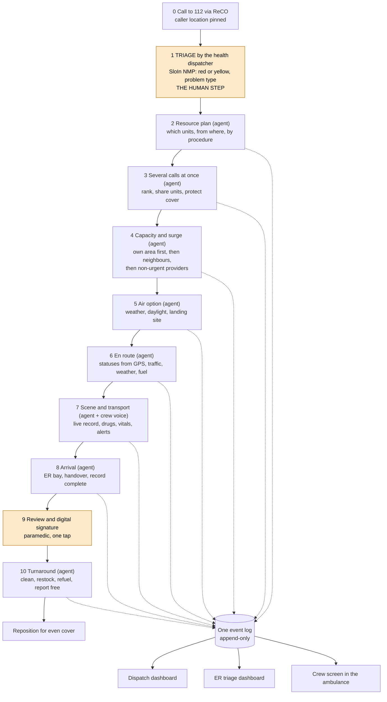
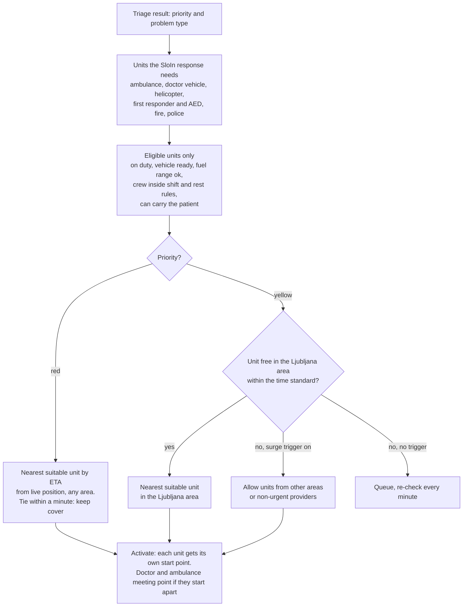
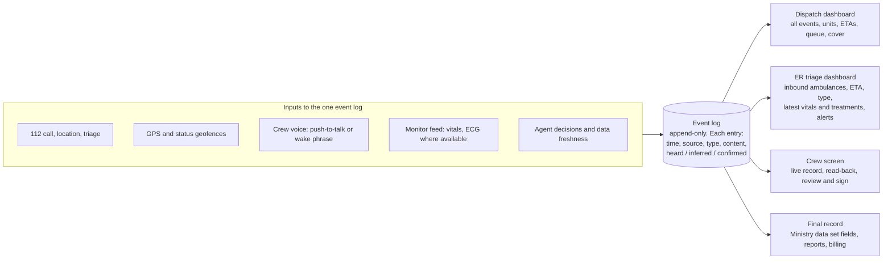

# Agentic dispatch: from the 112 call to "free"

Design for an EMS system where **a human triages the call and an agent runs everything after it**, following the procedures that already exist in Slovenia. Built on the research in [WORKFLOWS.md](WORKFLOWS.md), [LJUBLJANA_FLEET_AND_TEAMS.md](LJUBLJANA_FLEET_AND_TEAMS.md), [SURGE_AND_MULTI_SERVICE_COORDINATION.md](SURGE_AND_MULTI_SERVICE_COORDINATION.md), [OPERATIONS_DETAILS.md](OPERATIONS_DETAILS.md) and the team's engine in `backend/`. Written 2026-11-21. All patient data in a demo is synthetic. Picture copies of the three diagrams are in `diagrams/13` to `15`.

**Tags:** **[S]** read in the original document; **[SS]** from a news or search summary only; **[I]** my inference; **[A]** an assumption to be confirmed; **[?]** not found.

---

## 1. Decisions made so far

1. **The only mandatory human step is triage** by the health dispatcher. The second human touch is the paramedic's review and digital signature at the end. Everything between them is done by the agent.
2. **Units are chosen by the existing procedure**: nearest suitable team by live position. The agent may optimise only among units the procedure allows.
3. **Other areas are used only when it matters.** For a **red** (life-threatening) call the nearest suitable unit goes, from any area. For a **yellow** call only units in the Ljubljana area are used, unless the demand trigger below is on.
4. **Demand trigger (automatic):** free ambulances in the Ljubljana area fall below a set number, or the predicted arrival for a red call is over 15 minutes. The dispatcher is told, not asked.
5. **Voice entry by the paramedic:** push-to-talk **and** a wake phrase. Every entry is read back on screen.
6. **"Ljubljana area"** means the Ljubljana emergency area in the 2026 insurer's decree (section 3).
7. **Private ambulances.** For **non-urgent transports**: yes, once the regular teams are near full capacity. For **life-threatening calls**: it depends on how busy everyone is and on whether an ambulance from another region is near. If there is no such option, a private ambulance may be used (section 5.4).
8. **Signature:** assumed to be required. It is the **last step of the paramedic's documentation, at drop-off** (section 5.9).
9. **Colours:** red and yellow stay as the triage levels until told otherwise. Scenarios built on them are in [DISPATCH_SCENARIOS.md](DISPATCH_SCENARIOS.md).

Still to confirm: the full priority scheme in the national decision model (section 2). A contact is being asked.

---

## 2. Triage levels: what the sources say

The dispatcher sets the level with the national decision model, the **Slovenian Index for Emergency Medical Help (SloIn NMP)**.

| Level | Meaning | What the rules say happens | Source |
|---|---|---|---|
| **Red** (priority I) | A condition that endangers, or could soon endanger, the patient's life | The dispatcher activates the **nearest suitable mobile unit**, which must start the intervention at the latest **1 minute** after the activation call (art. 13). The **nearest helicopter team** is activated as needed (art. 14). **First responders** nearest to the scene are activated for a direct life threat (art. 17) | Dispatch rulebook, UL RS 58/2017 [S] |
| **Red, "orange criterion"** | A subset of priority I where the model's response is an ambulance team **without a doctor** | Only the nurse-and-rescuer ambulance (NRV) goes | Dispatch service plan, 2022 [S] |
| **Yellow** | A possible dangerous condition that may threaten vital functions, or a state a doctor must assess | Nearest suitable team; the quality standard is an intervention time of 60 minutes or less in 70 percent of cases | Dispatch rulebook, art. 3 and quality annex [S] |
| **Other responses** | Phone advice, a call passed to the patient's own doctor or the on-duty service | No vehicle (art. 16) | Dispatch rulebook [S] |

Other facts that matter:

- **Quality standards for red calls [S]:** average activation time (from setting the priority to the team confirming) of 20 seconds or less, 90 percent of red activations within 20 seconds, and the dispatch service's reaction time at 60 seconds or less.
- **The crew's own severity scale at the scene** is a different thing. The Ministry's data set lists *none (blue), mild (green), serious (orange), very severe (red), cardiac arrest* [S].
- **The decision model is being revised.** In 2026 the expert board for emergency medicine refused to approve a proposed second version "in its current form" (decision 2-7/2026) [S]. So the colours or criteria may change; the agent should read the mapping **from a table**, not have it fixed in code.
- **The text of SloIn NMP itself is not public** in anything I found [?]. I could not confirm whether it has more levels internally.

**Rule used for the cross-area decision:** "life-threatening" means **red**. Yellow is by definition only a *possibility* of danger, so it stays local. If the contact says the scheme has more levels, only the table changes.

---

## 3. What "Ljubljana area" means

Three nested areas exist. The design uses the middle one.

| Area | What it is | Size | Source |
|---|---|---|---|
| Ljubljana station area | The UKC ambulance station and its outposts (Ivančna Gorica, Vrhnika, Medvode) | Ljubljana plus 15 municipalities, 1,670 km², about 450,000 people | UKC reports [S] |
| **Ljubljana emergency area (used here)** | The "Ljubljana" group in the insurer's 2026 decree: UKC Ljubljana, ZD Ljubljana (3 doctor-vehicle teams), Domžale, Kamnik, Ivančna Gorica with Grosuplje, Vrhnika, Logatec, Kočevje, Ribnica, Idrija, Postojna, Cerknica | **12 units, 24.0 ambulance teams, 10 doctor-vehicle teams**, about 362 clinical staff [I]. It spans four statistical regions | Decree 2026, state of 1 May 2026 [S]; my map |
| Dispatch centre Ljubljana's competence | All municipalities handled by the Ljubljana dispatch centre | **92 municipalities, 1,179,304 people, 12,192 km²**: roughly the western half of the country, including Gorenjska and Primorska | Dispatch rulebook annex 4, 2017 [S] |

The statistical region I used on the map holds only 8 of these 12 units, so it is the wrong yardstick for this rule. The decree's emergency areas are the official ones.

**Crossing areas is normal and already recorded.** The Ministry's data set has a field "intervention outside the coverage area", and a 2024 instruction says that at night, for urgent cases, a doctor from the neighbouring unit is sent at the same time [S]. The red-only rule above matches that practice.

---

## 4. The flow end to end



---

## 5. Stage by stage

### 5.0 Call and location

- **Data:** the 112 call reaches the regional notification centre (ReCO) and then the dispatch centre with the **caller's position** and spoken answers [S, `LJUBLJANA_FLEET_AND_TEAMS.md`]. How the position is produced (handset location or other) was not researched [?].
- **Agent:** pins the location, finds the address and the nearest road, and opens an event with a unique id. Every later piece of data hangs on that id (the Ministry's data set uses the same idea [S]).

### 5.1 Triage (the human step)

- **The dispatcher** asks the questions and sets the level and the problem type with SloIn NMP. The agent never sets or changes a priority.
- **The agent quietly fills the "scene card"** on the dispatcher's screen from live data:
  - address, coordinates, and **access notes** such as closed approach, road works, stairs, lift (the Ministry's data set has exactly these fields [S]);
  - weather at the location; hazards and closures on the approaches;
  - the nearest public defibrillator (the dispatch service keeps a register of public AEDs and tells callers the nearest one in a cardiac arrest, art. 11 [S]; the demo uses a synthetic list);
  - the nearest hospital and helipad;
  - other open events nearby, so duplicate calls about the same accident are offered for merging (the dispatcher confirms).
- **Output of this step:** priority, problem type, and the SloIn response (ambulance only, with doctor, helicopter, first responders).

### 5.2 Choosing the units

The agent turns the SloIn response into a list of units to send and picks each one.



**Principle: procedure first, optimisation second.** The rule is the nearest suitable team by live GPS position. So ETA is the main key. The other factors are **eligibility filters** (a unit that fails one is not offered) and **tie-breakers**, never overrides.

| Factor | How it is used | Data | Status |
|---|---|---|---|
| Live position, not base | A unit returning from a job or at the hospital is closer than its base; ETA starts from where it is | Vehicle GPS (rule: in every vehicle, updates within 10 s) | [S] rule; demo simulated |
| ETA | Road time with traffic, works and weather (section 6) | World model | Engine has a simple version |
| Unit status | Free; returning and available; **conditionally available** (for example low on a consumable); cleaning; unavailable | The Ministry's operational statuses (section 5.10) | [S] |
| Crew | Inside the shift; break and daily-rest limits (30 min break counted as work; 12 h daily rest) | Roster | Rule [S]; shift times [A] |
| Fuel | Eligible only if range covers scene, hospital and the nearest fuel stop with a margin (section 6) | Fuel level per vehicle | Source [?] |
| Vehicle readiness | Not offered while it is cleaning or restocking, unless nothing else is eligible | Turnaround state | New |
| Capability | Stretcher, incubator (two ambulances can carry one), doctor on board | Vehicle record | [S] partly |
| Cover left behind | Used only as a tie-breaker within about a minute for red; a legal task of the dispatch service is even time-access (art. 11) | Coverage model | Rule [S] |
| Outside own area | Flag the event "intervention outside the coverage area" | Unit area table | [S] field |

**Several units, several start points.** A doctor vehicle may start at ZD Ljubljana, the ambulance at the UKC station and a helicopter at Brnik. The agent plans each separately. Two modes exist and both are used by the rules:

- **Simultaneous**: the doctor goes straight to the scene, as in the 2024 instruction for urgent cases [S].
- **Rendezvous**: when the doctor is needed only in part of the cases (10 to 30 percent of top-priority transports [S]), the doctor meets the ambulance on the way. The Ministry's own dispatch plan proposes this "rendez-vous" model [S].

The agent chooses the mode from the SloIn response and the ETAs and shows the meeting point to both crews.

### 5.3 Several calls at once

The agent ranks and shares units by explicit rules:

1. **Class first:** red before yellow before non-urgent.
2. **Never leave a red call unserved** while any eligible unit exists anywhere in range.
3. **Divert:** a unit on its way to a lower-priority job, with no patient aboard, can be diverted to a red call. The displaced job returns to the queue and its patient is told. A unit with a patient aboard is never diverted (the engine already has this rule [S, `backend/app/engine/actions.py`]).
4. **Two reds compete for the same unit:** the agent minimises total response time. If the triage code does not give a clinical order, the **dispatcher** is asked; that is part of triage, not of dispatch.
5. **Protect cover:** do not send the last free ambulance out of a sub-area for a yellow or non-urgent job if the predicted arrival for a red call there would pass 15 minutes.
6. **Merge duplicates** when the dispatcher confirms.

### 5.4 More demand than the area can handle

**Automatic trigger:** free ambulances in the Ljubljana area below a threshold, or a predicted red arrival over 15 minutes. The ladder is the one researched in [SURGE_AND_MULTI_SERVICE_COORDINATION.md](SURGE_AND_MULTI_SERVICE_COORDINATION.md):

| Step | What the agent does alone | Where a human is needed |
|---|---|---|
| 1 | Red calls: nearest unit from any area (always allowed). Yellow calls: allowed from the nearest neighbouring areas inside the Ljubljana dispatch centre's competence once the trigger is on | none |
| 2 | **Move scheduled non-urgent transports to contracted private or non-urgent providers.** All non-urgent transports already go through the dispatch service to providers under an insurer contract (art. 15), and under the 2026 rule non-urgent public providers must answer the dispatcher in a surge [SS]. This frees ambulance teams for emergencies | none |
| 3 | Hold non-urgent and discharge trips; call-in alert to off-duty crews | none |
| 4 | **Private ambulances for red calls, as the last option:** only when no public unit from any area reaches within 15 minutes and the private ambulance is faster. For yellow calls only if the wait is still over 45 minutes [A] | none for a single call. Inclusion of private ambulances in a **declared large disaster** follows the minister's decision [S] |
| 5 | Staff and resources of nearby health institutions for a special event (art. 16) | declaring the special event |
| 6 | **The army and the regional coordination group (art. 21)** | **Yes**: decisions by named authorities [S] |

**Your rule for private units, as built in.** **Non-urgent transports:** yes, once the regular teams are near full capacity (the demand trigger), because non-urgent transports already go to contracted providers through the dispatch service (art. 15). **Life-threatening calls:** it depends on how busy everyone is and on whether an ambulance from another region is near. The agent first takes the nearest public unit from **any** area. If none reaches within 15 minutes and a private ambulance would be faster, it sends the private one. **Open point:** whether private crews may legally take red calls outside a declared large disaster is not in anything I found [?]. Mass-casualty handling (METHANE report, triage cards, hospital alarm levels) stays as in the research document, with the agent preparing the allocation and a human declaring the event.

### 5.5 Helicopter

- **When:** red priority and the SloIn response includes the helicopter (art. 14). The agent evaluates it for every red call; this is a calculation, not a decision to fly.
- **Race:** helicopter time (13 minutes from call to take-off, then straight line at 200 km/h, then landing site to patient) against the ground ETA. If it is close, the agent **dispatches both** and cancels the ground unit when the helicopter reaches the patient first.
- **Can it fly?** METAR and TAF for the base and destination airports, ARSO observations, Open-Meteo points along the path (visibility, low cloud, gusts); daylight window (day only; 08:00 to sunset in winter, 16:30 in the 2026 schedule) [S]. The TAF gives the likely length of a grounding, so the agent **moves a ground ambulance before the fog arrives**.
- **Landing site:** helipads from OpenStreetMap (128 in Slovenia), hospital pads, open fields; police or fire are asked to secure the site (that is how it works today [S]). Slovenia has no register of sites outside heliports [S], so the agent keeps an informal list. The data set records the landing location and the type of air operation (primary, secondary, tertiary) [S].
- **Human:** the pilot's go or no-go and the helicopter doctor's call. These are set by the rules; the agent prepares the ground alternative and never overrides.

### 5.6 En route

- **Statuses come from GPS**, not from the crew: accepted, on the way, at the scene, with the patient, left the scene, at the destination (and for helicopters also arrival at the helicopter and take-off) [S, Ministry data set]. The crew confirms only exceptions. The timestamps feed the response-time indicators.
- **ETA refresh** from traffic, works, weather and fuel as they change. A closure ahead triggers a reroute at once.
- **Stall detection:** a unit stopped where it should be moving starts the breakdown flow: the nearest replacement unit is activated automatically, and the dispatcher is told. If a patient is aboard, the replacement goes first.
- **Hazard prompts to the crew:** ice, works, closed approaches, and the access notes for the final address.

### 5.7 At the scene and during transport

This is where the paramedic's hands are busy, so the agent listens and fills the record.

- **Automatic:** location, accident type, times, driving mode, kilometres, and, where a monitor can export them, **vital signs and ECG** (the data set lists "transfer of data from monitors" [S]).
- **By voice, push-to-talk or wake phrase** (section 8): drugs given (drug, dose, route, time), blood pressure and other vitals, procedures, events such as "stopped breathing".
- **On-scene severity** (blue, green, orange, red, arrest) spoken or tapped. A change to red or arrest makes the agent **request more resources through the normal channel** (doctor vehicle, helicopter) and tell the dispatcher.
- **Destination:** the agent recommends a hospital by capability (stroke, heart, trauma), free capacity and ETA. The crew or doctor confirms by voice or tap. Capacity comes from what hospitals report to the dispatch service (hourly once integrated, or within 15 minutes on request [S]); the demo uses synthetic numbers.
- **Everything goes to the ER dashboard live** (section 7).

### 5.8 Arrival and handover

- The pre-alert already reached the ER with a live ETA. The agent assigns a **bay**, shows the crew where to go, and shows the 15-minute handover timer (the legal maximum; the crew must report free right after handover or give the reason [S]).
- The **handover summary** (patient, event, leading problem, urgent conditions, history, vital signs during care [S]) is generated from the log and shown on both screens. Nothing is read out from memory.
- The record is completed and the patient data are available to the hospital by handover, which is what the 2026 rulebook asks [SS].

### 5.9 Review and signature

- The paramedic sees the finished record with **only the gaps and low-confidence entries highlighted**. Resuscitation and refusal-of-care content is always shown for review.
- **The signature is the last step of the paramedic's documentation, at drop-off**, after the handover summary. It is assumed to be required. One tap signs. The signed version is stored in the log with the name and time; later edits are tracked (the data set has a field for change history [S]).
- **Timing [proposal]:** review and signature have to fit inside the 15-minute handover window. If the record is still unsigned after 10 minutes, the screen prompts the paramedic. The unit is flagged "record unsigned" but is not held back from being reported free (the Ministry's statuses include conditional availability [S]).
- **Legal weight of the digital signature** (which standard the rulebook accepts) is [?]: the 2026 rulebook text was not read. In the demo the button stamps name, time and a hash.

### 5.10 Turnaround and "free"

- The Ministry's data set defines the crew's operational status after an intervention: **free, returning available, returning unavailable, cleaning, unavailable, conditionally available** [S]. The interventions must be closed no later than 15 minutes after handover unless justified [S].
- **Cleaning** is a real status. The crew gives the type (routine, heavy blood, airborne pathogen). Routine takes 5 to 10 minutes and heavy blood 30 to 45 [A, no published figure]. For heavy contamination the agent books a spare vehicle and a place to wash (the station has no wash space [S]).
- **Restock** is ordered from what the log says was used. **Refuelling** happens at a natural gap (about every 2 to 5 days of duty [I]) and earlier if the range filter needs it.
- Then the agent reports **free**, and the unit is **repositioned** if the cover score says so (art. 11 asks for even time-access).

---

## 6. Live data: what each signal changes

| Signal | What it changes | Sources | In the code today | Fallback |
|---|---|---|---|---|
| **Fuel** | Eligibility: range must cover scene, hospital and the nearest fuel stop with a margin [A: 25 percent]. Refuelling is scheduled at turnaround. Tank 75 L and 10 to 14 L per 100 km give about 400 to 560 usable km [I] | Fuel level per vehicle: from fleet telematics or fuel cards, not found [?] | No fuel state in `models.py` | Assume a level from km driven since the last refuel |
| **Weather and speed** | Multiplies road speed: snow, freezing rain, heavy rain and wind slow ambulances. Fog and low visibility also matter for the road and for the helicopter | Open-Meteo, MET Norway, ARSO, DARS road weather stations (NAP) | `weather_factor()` in `backend/app/routing.py` already applies snow (0.6 or 0.75), freezing rain (0.7), heavy rain (0.85), light rain (0.93), strong wind (0.85) | Keep these values; add fog and ice from road stations; later calibrate from GPS timings |
| **Helicopter can fly** | Go or no-go inputs and the ground fallback timing | METAR and TAF (LJLJ, LJMB, LJPZ), ARSO, Open-Meteo along the path, daylight table | No helicopter in the model | Last good METAR, labelled stale; assume grounded if unknown |
| **Traffic** | ETA and route choice | TomTom flow and incidents, NAP travel times, time-of-day profile | `traffic_factor` and incidents in `routing.py` | Time-of-day profile |
| **Reported works and closures** | Detours; time windows; access notes at the scene | promet.si text feed (157 of about 180 events were road works, Slovenian text, no coordinates), NAP road works (needs approval) | Incidents are circles with a radius | The text feed read by the language model, with a confidence |
| **Hospital capacity** | Destination, ER dashboard, redistribution | What hospitals report to the dispatch service (hourly after integration; 15 minutes on request) | None | Synthetic numbers, labelled |
| **Caller location** | Starting point of the whole flow | 112 call [S] | Calls are modelled as an address or coordinates | Typed address |

Every reading carries its **age**. A stale reading lowers confidence, and the dispatcher's screen says so. The engine already tracks fresh, stale and down per source.

---

## 7. The event log and the three dashboards



**One log, many views.** Each entry is appended and never edited; a correction is a new entry that points to the old one. A synthetic example:

```json
{
  "event_id": "EV-0001", "t": "2026-11-23T09:14:32+01:00", "unit": "A07",
  "source": "crew_voice", "type": "drug_administered",
  "content": {"drug": "morphine", "dose": "5 mg", "route": "IV"},
  "verbatim": "morfin pet miligramov intravenozno",
  "confidence": 0.93, "state": "heard"
}
```

`state` is **heard** (parsed from speech), **inferred** (derived by the agent) or **confirmed** (the crew tapped yes). Only confirmed entries go into the signed record without a highlight.

**ER triage dashboard** (the screen the emergency department watches):

- One card per inbound ambulance, **sorted by ETA**, with a live ETA, the priority, the on-scene severity, the problem type (chest pain, STEMI, stroke, breathing difficulty, severe head injury, resuscitation, polytrauma, sepsis, poisoning: the flags in the Ministry's data set [S]), age and sex, the **latest vital signs with their time**, and **treatments given** (drug, dose, route, time).
- **Alerts** the moment the log shows cardiac arrest or resuscitation started, return of circulation, an airway procedure, a stroke onset time (the time window matters), a STEMI, a blood transfusion, or vitals crossing limits that the hospital sets. The agent can suggest activating a stroke, heart or trauma team; **the ER decides**.
- A filter by destination hospital, a bay assignment, and after arrival a card with the **15-minute handover timer**.

**Dispatch dashboard:** all open events, all units on a map with their statuses, the queue, the cover map, the demand trigger state, the data freshness, and a **feed of everything the agent did and why**, which is also the audit trail.

**Crew screen in the ambulance:** the current task, route and hazards, the live record with each spoken entry read back, and the review and sign step at the end.

**Link to the Ministry's system.** The Ministry's new information system for emergency care (IS NMP) has a signed contract (15 January 2026, SRC Infonet), a pilot at Kranj and Jesenice in autumn 2026 and all units in 2027 [S]. It has a standard national data model, vital-sign transfer from monitors and no duplicate entry between teams [S]. Its **data set for documenting an intervention** (event, patient, performer, location, clinical state, vitals, drugs, procedures, devices, transport and statuses, outcome) is published. The event log should use those field names so that, when IS NMP arrives, the final record can be handed over without re-keying. One of the project's stated challenges is the failed renovation of the **dispatchers'** information system [S, slide wording; my reading]. This design is in that gap.

---

## 8. Voice capture

- **Two ways to start:** a push-to-talk button (screen or steering-wheel button) and a **wake phrase**. The phrase should not be an everyday word; "Zapis" below is a placeholder.
- **Language:** Slovenian. Browser speech recognition for `sl-SI` needs no key; a paid service is the fallback [S, `DATA_SOURCES.md`].
- **Read-back:** each entry appears on the crew screen and can be confirmed with a tap or by saying "potrjeno" (confirmed). Unconfirmed entries show in the ER dashboard as **heard**.
- **What the agent parses:** drugs (name, dose, unit, route, time), vitals, procedures, events (arrest, return of circulation, defibrillation, airway), severity change, and free comments.
- **Hard rules:** it writes down **what was said**. It never fills in or suggests a dose, never corrects a value silently, and puts an unclear number in a "check this" state.
- **Numbers from a monitor beat numbers from speech**, where the monitor can export them. Speech is the backup and the way to record treatments.
- **Noise:** a moving ambulance with a siren is a hard place for speech recognition. A headset or cab microphone is assumed; a tap-to-enter fallback always exists.

Illustrative utterances (my Slovenian drafts, to be checked by a native speaker):

| Utterance | Entry |
|---|---|
| "Zapis, morfin pet miligramov intravenozno." | drug: morphine, 5 mg, IV, now |
| "Zapis, krvni tlak sto dvajset na osemdeset, saturacija devetdeset dva." | vitals: BP 120/80, SpO2 92, now |
| "Zapis, bolnik je prenehal dihati, začenjam oživljanje." | event: respiratory arrest, resuscitation started; **alert to the ER** |

---

## 9. Procedures the agent follows

| Rule | Source | How the agent follows it |
|---|---|---|
| Red: nearest suitable unit, starting within 1 minute of the activation call | Dispatch rulebook art. 13 [S] | Selection by ETA from live position; activation time is measured from the priority to the "accepted" status |
| Red: nearest helicopter team as needed | art. 14 [S] | Air option evaluated for every red call; dual dispatch |
| Direct life threat: nearest first responders; nearest AED | art. 17 and art. 11 [S] | Added to the resource plan |
| Even time-access of the service | art. 11 task 17 [S] | Cover score, tie-breakers, repositioning |
| Non-urgent transports ordered through the dispatch service, given to providers under an insurer contract | art. 15 [S] | Private and contracted providers get non-urgent trips automatically |
| Special events: nearby health institutions can join | art. 16(2) [S] | Step 4 of the ladder |
| Hospitals report free capacity to the dispatch service | art. 18 and annex 6 [S] | Capacity state feeds destination and ER dashboard |
| Vehicle positions monitored; fast decision models | art. 11(2) [S] | Live GPS drives selection |
| Handover at most 15 minutes; then report free or give the reason | art. 22 [S] | Handover timer; "free" at once |
| Replacement vehicle after breakdown within 2 hours at most | art. 22 [S] | Spare vehicle booked at once |
| Record electronically and as automatically as possible; all calls and radio recorded and kept for one year | art. 29 [S] | The event log |
| Nearest team regardless of provider area; 15-minute average for red; exit time 1 minute; digital record by handover | 2026 NMP rulebook, from news and the Ministry statement [SS]; text not read | Area rule, indicators, record |
| Report to the Ministry every six months | station and rulebook [S] | Generated from the log |

---

## 10. Where a human is still involved

Only where the rules put one there, or the agent cannot proceed safely:

1. **Triage** (the dispatcher) and **changing a priority**.
2. **The paramedic's review and signature**, and the doctor's clinical decisions on scene.
3. **Pilot go or no-go** and the helicopter doctor's call.
4. **Destination for red cases**, confirmed by the crew or doctor.
5. **Declaring a special event or a mass-casualty event**, the army, the regional coordination group, and private ambulances in a declared large disaster.
6. **Two red calls competing** with no clinical order in the triage code.
7. **A high-consequence infectious pathogen** in the vehicle (infection control).
8. **No live position for any eligible unit** on a red call: the dispatcher decides.
9. **The ER's call** to activate a specialist team.

---

## 11. What fits before coding stops on Sunday 11:00

Most of this touches `backend/app/models.py` and `backend/app/engine/`, which teammates own, so it needs agreement first. This document changes no code. The slices that make the best 3-minute story, in order:

1. **Call to dispatch.** A call form with a pinned location; a triage form (red or yellow, problem type) as the one manual click; the agent's resource plan using procedure-first selection with the area rule; units shown starting from different places.
2. **Event log and ER dashboard.** The log, a second screen for the ER with inbound ambulances, ETA and type, and voice entries (typed fallback) appearing there live.
3. **Review and sign.** The finished record with highlighted gaps and a sign button.
4. **Filters and gates.** Fuel eligibility, weather on ETA (already in the engine), helicopter fog gate (needs a helicopter vehicle type), private providers taking non-urgent trips when the trigger fires.

Test material for these slices: [DISPATCH_SCENARIOS.md](DISPATCH_SCENARIOS.md) (11 scenarios from one ambulance to a 22-patient event, with engine-ready events).

Not for Sunday: monitor integration, IS NMP import, real hospital capacity, a real fuel feed, wake-phrase accuracy in a real ambulance.

---

## 12. Open questions

- **Full SloIn NMP scheme** (levels, criteria, responses). A contact is being asked. Until then red and yellow are used and the mapping is a table.
- **2026 NMP rulebook text** (UL RS 666/2026) was not read; the official gazette site failed here. It may fix the digital-signature rule, the response standards and what counts as a unit's "area".
- **Private crews on red calls:** whether they may take them outside a declared large disaster, and for yellow calls the rule used (private only if the wait is over 45 minutes even with other areas).
- **Caller location:** how it reaches the dispatcher in practice.
- **Fuel:** is there a fuel level in vehicle telematics or fuel-card data?
- **Hospital capacity:** the format and timing of what hospitals actually report.
- **Which monitors** the Ljubljana crews use and whether they export vital signs.
- **Cleaning times and the wash place** are assumptions.
- **Shift start times** (07:00 and 19:00) are assumptions.
- **Data protection** for voice recordings and the ER dashboard.

---

## 13. Sources

- Dispatch rulebook, Uradni list RS 58/2017, articles 2, 3, 11 to 19, 22, 29, annexes 4 and 6: https://pisrs.si/api/uradni-list/objava/u2017058.pdf
- Ministry of Health, data set for documenting emergency medical interventions: https://www.gov.si/assets/ministrstva/MZ/DOKUMENTI/1-TEME/Organiziranost-zdravstvenega-varstva/Nabor-podatkov-za-nujno-medicinsko-pomoc.pdf
- Ministry of Health, IS NMP presentation, 3 March 2026: https://www.gov.si/assets/ministrstva/MZ/DOKUMENTI/2-NOVICE/03032026_Konferenca-eZdravje-NOO-2026/IS-NMP.pdf
- Ministry of Health, IS NMP news, 19 June 2026: https://www.gov.si/novice/2026-06-19-predstavljamo-novo-informacijsko-resitev-za-podporo-sluzbam-nujne-medicinske-pomoci-is-nmp
- Dispatch service establishment plan (priority I, orange criterion, rendezvous model): https://www.gov.si/assets/ministrstva/MZ/DOKUMENTI/ZDRAVJE/organiziranost/Nacrt-vzpostavitve-Dispecerske-sluzbe-zdravstva.pdf
- Expert board for emergency medicine, minutes of the 35th session 2026 (SloIn version 2 not approved): https://www.gov.si/assets/ministrstva/MZ/DOKUMENTI/4-ZBIRKE/RSK/RSK-urgentna-medicina/2026/RSK-za-urgentno-medicino-zapisnik-35.-seje-2026.pdf
- Ministry instruction on a shared on-duty point, 6 March 2024 (doctor from the neighbouring unit sent in urgent cases): https://www.gov.si/assets/ministrstva/MZ/DOKUMENTI/1-TEME/Navodilo_izvajalcem_sluzbe_NMP_-6-_3-_2024.pdf
- Insurer programme decree 2026, emergency areas and team counts (state 1 May 2026): https://www.zzzs.si/fileadmin/user_upload/dokumenti/novice/2026/uredba_2026_17.4.2026.pdf
- Team engine: `backend/app/routing.py`, `backend/app/models.py`, `backend/app/engine/actions.py`
- Earlier research in this folder: [EMS_RESEARCH.md](EMS_RESEARCH.md), [DATA_SOURCES.md](DATA_SOURCES.md), [AMBULANCE_MAP.md](AMBULANCE_MAP.md), [DATA_FRESHNESS.md](DATA_FRESHNESS.md)
