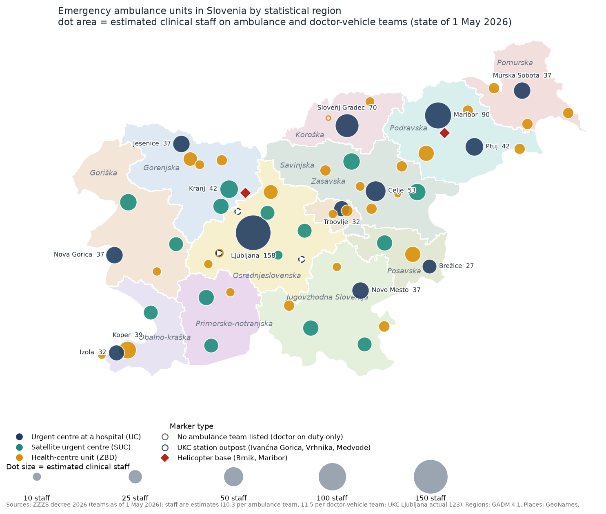

# Map of emergency ambulance units in Slovenia

**Files** (all in `docs/map/`): [`ambulance_map.html`](map/ambulance_map.html) (interactive: hover any dot, works offline), [`ambulance_map.png`](map/ambulance_map.png) (static), [`ambulance_units.json`](map/ambulance_units.json) (the data), [`region_summary.json`](map/region_summary.json).

Companion to [LJUBLJANA_FLEET_AND_TEAMS.md](LJUBLJANA_FLEET_AND_TEAMS.md) and [DATA_FRESHNESS.md](DATA_FRESHNESS.md). Built 2026-11-21.

**Tags:** **[S]** read in the source; **[I]** my estimate or arithmetic; **[SS]** from a news report only.

---

## 1. How to read the map

- **Regions** are Slovenia's 12 statistical regions. Each unit is placed in the region its town falls in, by testing its coordinates against the region borders.
- **Dot area** is the **estimated number of clinical staff** on that unit's ambulance and doctor-vehicle teams. The larger the dot, the more crews and vehicles the unit runs.
- **Dot colour** is the type of unit: a hospital urgent centre (UC), a satellite urgent centre (SUC), or a health-centre unit (ZBD).
- **Vehicles and staff move together** on purpose: the staff figure is calculated from the team counts, so a dot with more vehicles is also a bigger dot. Hover a dot in the HTML version for the vehicles and staff of each organisation in that town.
- **A "team" of 1.0 is one vehicle crewed round the clock**; 1.5 means a second vehicle is crewed for part of the day. So the vehicle counts here are **vehicles on duty**, not the whole fleet (the Ljubljana station's whole fleet was 30 vehicles in 2022 [S]).

## 2. Where the numbers come from

| Item | Value | Source | Tag |
|---|---|---|---|
| Teams per unit | table "emergency medical service with on-duty service, state of **1 May 2026**" (the newer of two tables in the decree; the other is 1 Jan 2026) | ZZZS programme decree 2026, annex | [S] |
| Check on the extraction | national totals **104.0 ambulance teams and 43.1 doctor-vehicle teams**, equal to the decree's own total row | same | [S] |
| Staff per ambulance team | **10.28** (5.14 graduate nurses + 5.14 driver-rescuers) | the insurer's price annex | [S] |
| Staff per doctor-vehicle team | **11.5** (a doctor at 1,430 working hours a year and a nurse or rescuer at 1,620, covering 8,760 hours) | the decree's planning hours | [I] |
| Check on the formula | Ljubljana station: 12 teams x 10.28 = **123.4** estimated, against **123** real clinical staff (76 nurses or technicians + 47 rescuers) on 31 Dec 2025 | UKC annual report 2025 | [S] |
| UKC Ljubljana dot | uses the real 123 | UKC annual report 2025 | [S] |
| Region borders | GADM 4.1 level 1 (12 statistical regions; named as the statistics office does) | gadm.org, free for non-commercial use | [S] |
| Unit locations | centre of the named town (GeoNames, CC BY 4.0), **not the street address of the base** | geonames.org | [I] |

## 3. Totals by region

| Region | Units | Ambulance teams | Doctor-vehicle teams | Est. clinical staff | Hospital urgent centres |
|---|---|---|---|---|---|
| Gorenjska | 6 | 11.5 | 4 | 164 | Jesenice |
| Goriška | 4 | 7.5 | 3 | 112 | Nova Gorica |
| Jugovzhodna Slovenija | 6 | 9.5 | 3.5 | 138 | Novo Mesto |
| Koroška | 5 | 5.5 | 2.2 | 82 | Slovenj Gradec |
| Obalno-kraška | 4 | 5 | 4.8 | 107 | Izola |
| Osrednjeslovenska | 8 | 17.5 | 8 | 272 | Ljubljana |
| Podravska | 5 | 14 | 4.5 | 196 | Maribor, Ptuj |
| Pomurska | 4 | 7 | 1 | 83 | Murska Sobota |
| Posavska | 3 | 5.5 | 3 | 91 | Brežice |
| Primorsko-notranjska | 3 | 4.5 | 2 | 69 | none |
| Savinjska | 8 | 13 | 5.1 | 192 | Celje |
| Zasavska | 3 | 3.5 | 2 | 59 | Trbovlje |
| **Slovenia** | **59** | **104** | **43.1** | **1565** | |

Estimated clinical staff total about **1,565** for the whole country (nurses, technicians and rescuers on ambulance and doctor-vehicle teams; doctors on doctor-vehicle teams are included in the 11.5).

## 4. Extra markers

- **Outposts of the Ljubljana station** (white dashed dots): **Ivančna Gorica, Vrhnika and Medvode**. Ivančna Gorica and Vrhnika are in the 2024 and 2025 annual reports [S]; Medvode is reported as a new dislocated unit in June 2026 [SS]. Their teams belong to the station's 12 ambulance teams, and the split between the main base and the outposts is **not published**, so they have no size of their own.
- **Helicopter bases** (red diamonds): **Brnik** (flown with the army's Bell 412, 08:00 to 16:30 in winter 2026, 344 missions in 2025) and **Maribor** [S]. Locations are the airports.
- **Hollow dots**: units where the table lists **no ambulance or doctor-vehicle team**, only an on-duty doctor service (the hospital urgent centre at Slovenj Gradec, Ravne and Dravograd). In the Koroška region the ambulance teams belong to the regional rescue centre (ZRCK), shown at Slovenj Gradec.
- **Ivančna Gorica and Grosuplje** share one satellite urgent centre in the table; it is drawn at Grosuplje.

## 5. All units

| Unit | Type | Statistical region | Urgent-centre area in the decree | Ambulance teams | Doctor-vehicle teams | Est. staff |
|---|---|---|---|---|---|---|
| ZD Kranj | SUC | Gorenjska | JESENICE | 3 | 1 | 42.4 |
| (SB in ZD Jesenice) | UC | Gorenjska | JESENICE | 2.5 | 1 | 37.2 |
| ZD Škofja Loka | SUC | Gorenjska | JESENICE | 2 | 1 | 32.1 |
| ZD Bled-Bohinj | ZBD | Gorenjska | JESENICE | 2.5 | 0 | 25.7 |
| ZD Tržič | ZBD | Gorenjska | JESENICE | 1.5 | 0 | 15.4 |
| ZD Radovljica | ZBD | Gorenjska | JESENICE | 0 | 1 | 11.5 |
| (SB in ZD N. Gorica) | UC | Goriška | NOVA GORICA | 2.5 | 1 | 37.2 |
| ZD Tolmin | SUC | Goriška | NOVA GORICA | 2.5 | 1 | 37.2 |
| ZD Idrija | SUC | Goriška | LJUBLJANA | 1.5 | 1 | 26.9 |
| ZD Ajdovščina | ZBD | Goriška | NOVA GORICA | 1 | 0 | 10.3 |
| (SB in ZD Novo mesto) | UC | Jugovzhodna Slovenija | NOVO MESTO | 2.5 | 1 | 37.2 |
| ZD Kočevje | SUC | Jugovzhodna Slovenija | LJUBLJANA | 2 | 1 | 32.1 |
| ZD Črnomelj | SUC | Jugovzhodna Slovenija | NOVO MESTO | 1.5 | 1 | 26.9 |
| ZD Metlika | ZBD | Jugovzhodna Slovenija | NOVO MESTO | 1 | 0.5 | 16 |
| ZD Ribnica | ZBD | Jugovzhodna Slovenija | LJUBLJANA | 1.5 | 0 | 15.4 |
| ZD Trebnje | ZBD | Jugovzhodna Slovenija | NOVO MESTO | 1 | 0 | 10.3 |
| Zdravstveno reševalni center Koroške | ZBD | Koroška | SLOVENJ GRADEC | 5.5 | 1.2 | 70.4 |
| ZD Radlje | ZBD | Koroška | SLOVENJ GRADEC | 0 | 1 | 11.5 |
| (SB in ZD Sl. Gradec) | UC | Koroška | SLOVENJ GRADEC | 0 | 0 | 0 |
| ZD Dravograd | ZBD | Koroška | SLOVENJ GRADEC | 0 | 0 | 0 |
| ZD Ravne | ZBD | Koroška | SLOVENJ GRADEC | 0 | 0 | 0 |
| ZD Koper | ZBD | Obalno-kraška | IZOLA | 1 | 2.5 | 39.1 |
| (SB in ZD Izola) | UC | Obalno-kraška | IZOLA | 2.5 | 0.5 | 31.5 |
| ZD Sežana | SUC | Obalno-kraška | IZOLA | 1.5 | 1 | 26.9 |
| ZD Piran | ZBD | Obalno-kraška | IZOLA | 0 | 0.8 | 9.2 |
| UKC Ljubljana | UC | Osrednjeslovenska | LJUBLJANA | 12 | 0 | 123 |
| ZD Ljubljana | ZBD | Osrednjeslovenska | LJUBLJANA | 0 | 3 | 34.6 |
| ZD Domžale | SUC | Osrednjeslovenska | LJUBLJANA | 1.5 | 1 | 26.9 |
| ZD Kamnik | ZBD | Osrednjeslovenska | LJUBLJANA | 1.5 | 1 | 26.9 |
| ZD Litija | SUC | Osrednjeslovenska | TRBOVLJE | 1.5 | 1 | 26.9 |
| ZD Ivančna Gorica in ZD Grosuplje | SUC | Osrednjeslovenska | LJUBLJANA | 0 | 1 | 11.5 |
| ZD Vrhnika | ZBD | Osrednjeslovenska | LJUBLJANA | 0 | 1 | 11.5 |
| ZD Logatec | ZBD | Osrednjeslovenska | LJUBLJANA | 1 | 0 | 10.3 |
| (UKC in ZD Maribor) | UC | Podravska | MARIBOR | 6 | 2.5 | 90.5 |
| ZD Ptuj | UC | Podravska | MARIBOR | 3 | 1 | 42.4 |
| ZD S. Bistrica | ZBD | Podravska | MARIBOR | 2 | 1 | 32.1 |
| ZD Lenart | ZBD | Podravska | MARIBOR | 1.5 | 0 | 15.4 |
| ZD Ormož | ZBD | Podravska | MARIBOR | 1.5 | 0 | 15.4 |
| (SB in ZD M. Sobota) | UC | Pomurska | MURSKA SOBOTA | 2.5 | 1 | 37.2 |
| ZD G. Radgona | ZBD | Pomurska | MURSKA SOBOTA | 1.5 | 0 | 15.4 |
| ZD Lendava | ZBD | Pomurska | MURSKA SOBOTA | 1.5 | 0 | 15.4 |
| ZD Ljutomer | ZBD | Pomurska | MURSKA SOBOTA | 1.5 | 0 | 15.4 |
| ZD Krško | ZBD | Posavska | BREŽICE | 2 | 1 | 32.1 |
| ZD Sevnica | SUC | Posavska | BREŽICE | 2 | 1 | 32.1 |
| (SB in ZD Brežice) | UC | Posavska | BREŽICE | 1.5 | 1 | 26.9 |
| ZD Postojna | SUC | Primorsko-notranjska | LJUBLJANA | 2 | 1 | 32.1 |
| ZD Ilirska Bistrica | SUC | Primorsko-notranjska | IZOLA | 1.5 | 1 | 26.9 |
| ZD Cerknica | ZBD | Primorsko-notranjska | LJUBLJANA | 1 | 0 | 10.3 |
| (SB Celje) | UC | Savinjska | CELJE | 3.5 | 1.5 | 53.3 |
| ZD Velenje | SUC | Savinjska | CELJE | 2.5 | 1 | 37.2 |
| ZD Šmarje/Jelše | SUC | Savinjska | CELJE | 2.5 | 1 | 37.2 |
| ZD Laško | ZBD | Savinjska | CELJE | 1.5 | 0 | 15.4 |
| ZD Nazarje | ZBD | Savinjska | CELJE | 1.5 | 0 | 15.4 |
| ZD Sl. Konjice | ZBD | Savinjska | CELJE | 1.5 | 0 | 15.4 |
| ZD Žalec | ZBD | Savinjska | CELJE | 0 | 1 | 11.5 |
| ZD Šentjur | ZBD | Savinjska | CELJE | 0 | 0.6 | 6.9 |
| (SB in ZD Trbovlje) | UC | Zasavska | TRBOVLJE | 2 | 1 | 32.1 |
| ZD Hrastnik | ZBD | Zasavska | TRBOVLJE | 0.5 | 1 | 16.7 |
| ZD Zagorje | ZBD | Zasavska | TRBOVLJE | 1 | 0 | 10.3 |

## 6. What is not on the map

- **Private and non-urgent ambulance firms.** Their bases are not published in a list I could find; the public network counted 62 providers in an older report [SS].
- **The whole fleet per unit.** Only vehicles on duty are known per unit, plus the Ljubljana station's total.
- **Real staff per unit.** Except for Ljubljana, staff are estimates from team counts. Doctors who work on-duty services (DS1 and similar) and administrative staff are not counted.
- **Military ambulances and the army's medical units.** No standing list found (see [SURGE_AND_MULTI_SERVICE_COORDINATION.md](SURGE_AND_MULTI_SERVICE_COORDINATION.md)).
- **The urgent-centre areas** in the decree (11 groups such as "Jesenice" or "Izola") are **not** the same as the 12 statistical regions; both are shown in the unit table.

## 7. Sources

- ZZZS programme decree 2026, annex "Nujna medicinska pomoč z dežurno službo na stanju 1. 5. 2026": https://www.zzzs.si/fileadmin/user_upload/dokumenti/novice/2026/uredba_2026_17.4.2026.pdf
- UKC Ljubljana annual report 2025 (staff, fleet context): https://www.kclj.si/dokumenti/LetnoPorociloUKCL_2025.pdf
- HNMP Brnik site (aircraft, hours, missions): https://www.hnmp.info/hnmp-brnik-aktivacija/statistika/
- Žurnal24, June 2026 (Medvode unit): https://www.zurnal24.si/zdravje/nmp-nujna-medicinska-pomoc-pravilnik-informacijski-sistem-461340
- Region borders, GADM 4.1: https://gadm.org
- Place coordinates, GeoNames: https://www.geonames.org
