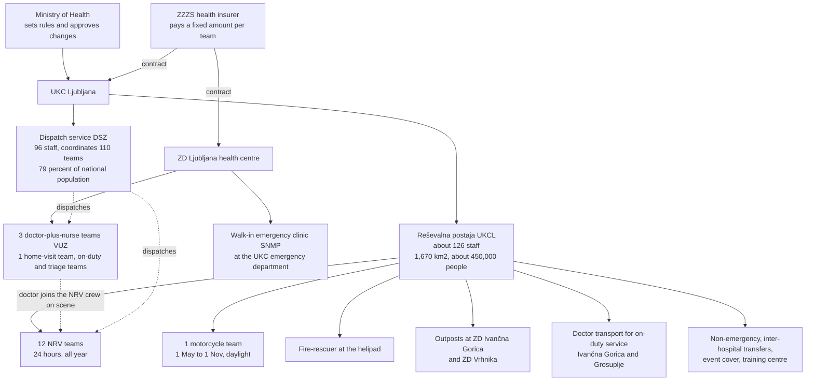
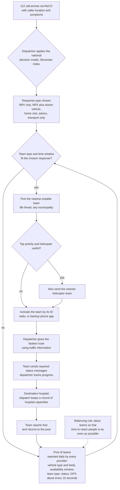

# Ljubljana ambulance fleet, teams, dispatch decision, shifts, servicing

Companion to [EMS_RESEARCH.md](EMS_RESEARCH.md) and [WORKFLOWS.md](WORKFLOWS.md). Researched 2026-11-21.

**Tags:** **[S]** stated in a source I read; **[I]** my inference or arithmetic from sourced numbers; **[?]** not found; **[SS]** only seen in a web-search summary, not yet confirmed in the original text.

**Updated figures (2025 annual report):** 48,754 interventions and 16,087 life-threatening at dispatch; 137 station staff (76 nurses or health technicians, 47 rescuers, 14 other); dispatch coordinates up to 123 teams; UKC bought ambulances with its own funds; the station has its own renovated workshop (outside repairs average 12 to 96 hours); the dispatch software is Computel NMP 3000. Details and the status of every gap are in [GAPS_STATUS.md](GAPS_STATUS.md). The 2024 and 2022 figures below are kept for the trend.

---

## 1. Short answers

| Question | Answer | Tag |
|---|---|---|
| How many vehicles in Ljubljana? | **29 vehicles in 2018, 30 at the end of 2022** at the UKC Ljubljana ambulance station (Reševalna postaja, RPUKCL): 11 modular ambulances, 10 combined ambulances, 2 sanitary-transport vehicles, 3 rescue motorcycles, 1 service vehicle, 1 education-centre vehicle. Plus 2 dedicated ambulances of the children's clinic for critically ill children. No 2025-26 count found | [S] |
| How many teams? | **12 emergency-ambulance teams (NRV) and 1 motorcycle team** at UKC Ljubljana; ZD Ljubljana adds **3 doctor-plus-nurse teams (VUZ)**, 1 home-visit team and on-duty teams. **Up to 16 teams can work at the same time; up to 25 vehicles in an emergency** | [S] |
| How are teams organised? | NRV crew = a graduate nurse or health technician (team leader) + a medical rescuer who also drives. A doctor joins via a separate doctor vehicle (VUZ), or exceptionally rides in a three-person resuscitation crew | [S] |
| Who decides which vehicle goes? | A health dispatcher at the dispatch centre (DCZ), using the national decision model, picks the **nearest suitable team** by live GPS position | [S] |
| Employee schedule? | 12-hour day shift, next day 12-hour night shift, then 2 days off; round the clock, every day. About 126 staff | [S] |
| Service interval? | **Not published.** Maintenance is outsourced under 24-month framework contracts. 2018 average was 32,802 km per vehicle per year | [?] for the interval, [S] for the rest |

---

## 2. Organisation (who is who)

- **Coverage [S]:** Ljubljana plus 15 neighbouring municipalities, 1,670 km², about 450,000 people living and working there (2022 and 2024 sources). The 2018 page said 14 municipalities and 1,470 km², so the area grew.
- **Volume [S]:** **49,352 interventions in 2024, of which 15,497 were life-threatening at dispatch.** That is about 135 interventions per day, about 42 of them life-threatening **[I, arithmetic]**. The 2018 figures conflict between two pages of the same site (50,457 with 26,340 urgent, versus 41,441 with 10,822 urgent); use 2024.
- **Staff [S]:** on 31 Dec 2024: **126** employees = 66 graduate nurses or health technicians, 46 medical rescuers, 15 non-health staff. End of 2022: over 110 rescuers (the site says the largest ambulance station in Slovenia).
- **Teams in the law [S]:** the 2026 ZZZS decree names UKC Ljubljana's programme as 12 NRV teams + 1 motorcycle team, plus the helicopter and dispatch services. For ZD Ljubljana it lists 3 VUZ teams, 1 home-visit team, 5 on-duty (DS1) teams, 2.5 rapid-exam teams in working hours, 1.5 triage and admission teams, 0.8 emergency-centre team.
- **What a "team" is in the law [S]:** the decree plans team numbers on **1,430 effective hours per year per doctor and 1,620 per nurse**. A continuously staffed 24-hour team therefore needs several people per seat **[I]**.
- **ZD Ljubljana merger [S, 2018 page]:** the walk-in clinic (SNMP) was to move under UKC Ljubljana. I did not confirm whether it has.

### Team types

| Type | Crew | Used for | Tag |
|---|---|---|---|
| MoE NRV (emergency ambulance unit) | Graduate nurse or health technician (leader) + medical rescuer (also drives) | Standard emergency response | [S] |
| MoE REA (resuscitation unit) | Doctor (leader) + nurse + rescuer, in the same vehicle | Exceptionally, by intervention type and urgency | [S] |
| VUZ (doctor vehicle) | Doctor + graduate nurse or rescuer | Drives to the scene and joins the NRV crew | [S] |
| Motorcycle rescuer | One rescuer | Fast first response, 1 May to 1 Nov, daylight and safe weather | [S] |
| Helipad fire-rescuer | Trained staff | Called out for each helicopter arrival | [S] |
| Helicopter (HNMP) | Doctor + nurse or technician, flown by police or army | See EMS_RESEARCH.md | [S] |

The dispatch service's own establishment plan says a doctor is really needed in only **10 to 30 percent** of top-priority interventions, which is why the nurse-and-rescuer NRV is sent first **[S, dispatch-service plan, Nov 2022]**.

---

## 3. How a vehicle gets chosen

| Step | Data in | Depends on | Tag |
|---|---|---|---|
| Call intake | Caller GPS position from the 112 call, spoken answers to key questions | ReCO, DCZ | [S] |
| Decision model | Answers mapped to the Slovenian Index for Emergency medical help (priority colours; the "orange" level can be sent an NRV without a doctor) | Protocol; dispatcher judgement | [S] |
| Team pool | Each day providers send: vehicle type (beds, equipment, car for a doctor), availability window (for example 07:30 to 15:30), team type (with doctor, without, doctor only), team position and status | Providers actually supplying the contracted number of teams and logging in | [S] |
| Positions | Every vehicle must carry a radio, a GPS transmitter (position, speed, engine running, blue-light use), a navigation device and a tablet. Data must reach dispatch in real time or within **10 seconds**, with **99.5 percent** availability | The 2017 dispatch rulebook (OJ RS 58/2017), art. 11 | [S, via the Information Commissioner's 2019 opinion] |
| Selection | Position of the incident against positions of free, suitable teams | Life threat: nearest regardless of municipality | [S] |
| Activation | Team ID | State radio network for health (DRO DMR) had coverage problems, so a backup phone app (Intervencije.net) is used. Some providers resisted it | [S, dispatch-service plan, Nov 2022] |
| Routing | Traffic information | Dispatcher orders the fastest path; the actual routing software is **not named** | [S] for the intent, [?] for the engine |
| Status messages | Prescribed messages from each crew | Compliance. Missing or wrong messages cause wrong activations and long access times | [S] |
| Hospital choice | Capacity records of hospitals, urgent centres and health institutions in the network | Kept by dispatch under the rulebook | [S] |

**Known failure modes (from the dispatch service's own establishment plan, Nov 2022) [S]:** teams not registered where the contract says they should be; members not logging in or logging in wrongly, causing the wrong team to be sent; crews rejecting or adapting some responses; incomplete status messages; reserve vehicles below the required quota; old fleets. These are realistic "chaos" events for the challenge.

**Why this matters for the challenge:** the real system already does what the challenge asks in part. It maintains a live pool of teams with position and status, picks the nearest suitable one, and needs to re-pick when a team becomes unavailable.

---

## 4. Employee schedule

- **Shift pattern [S, station website]:** one **12-hour day shift**, usually followed the next day by a **12-hour night shift**, then **2 days off**. Work runs 24 hours a day, every day of the year.
- **Rotation arithmetic [I]:** a 4-day cycle (day, night, off, off) means each seat needs **4 rotating staff**. With 12 NRV teams of 2 seats that is about 96 people, which fits the 112 nurses and rescuers once motorcycle, helipad, non-emergency and training roles are added.
- **Shift leaders [S]:** the station website lists "shift leaders" (vodje izmen).
- **Handover [S]:** before shift end the crew cleans the ambulance floor, wipes all contact surfaces with disinfectant, empties bins and washes the outside if needed, so the next crew finds it ready.
- **Motorcycle [S]:** 1 May to 1 Nov, daylight, only when conditions are safe. In 2018 the motorcycle team made 455 interventions.
- **Helicopter [S]:** Brnik 08:00 to 20:00 in summer, to sunset in winter (see EMS_RESEARCH.md).
- **Planning hours [S]:** 1,430 effective hours per doctor, 1,620 per nurse, per year (ZZZS decree).
- **Pressure [S]:** UKC says the dispatch service could not fill all planned posts in 2024 because of workload, staff leaving for lighter jobs, and a pay gap with other EMS staff that opened in late 2021. Dispatch had 96 staff at year end.
- **Not found [?]:** the exact roster for each seat, shift start times, rest-day rules by team, and how breaks are scheduled.

---

## 5. Vehicle servicing and lifetime

- **Maintenance is outsourced [S, 2026 EU tender notice, UKC Ljubljana]:** a framework contract for maintaining the ambulance station's fleet, estimated value **€1,603,920 excl. VAT**, six lots, 24 months each:

| Lot | Scope | Outcome | Value |
|---|---|---|---|
| 1 | Ambulances on Volkswagen vehicles | No winner: the one tender received was withdrawn or inadmissible | n/a |
| 2 | Ambulances on MAN vehicles | No winner: no tenders received | n/a |
| 3 | Ambulances on Mercedes-Benz vehicles | AUTOCOMMERCE d.o.o. | €40,224.39 |
| 4 | Superstructures, conversions and fit-out of the base vehicle | SKULJ storitveno podjetje d.o.o. | €339,405.32 |
| 5 | Rescue motorcycles (Honda) | AS Domžale Moto Center d.o.o. | €15,084.15 |
| 6 | Technical inspections and registration for all station vehicles | Ljubljanski potniški promet (city bus company) | €6,979.44 |

  Awarded in total about €401,693. Two ambulance-maintenance lots (VW, MAN) were unfilled, so those vehicles may be maintained another way **[I]**.
- **Mileage and age [S, 2018 station page]:** average vehicle age **6.6 years**, oldest 16 years (being written off), newest 3 months; **787,255 km** driven in 2018; **32,802 km per vehicle** on average.
- **Replacement limits [SS]:** an emergency ambulance may serve up to about **350,000 km** or an age limit of 6 to 10 years depending on function; non-emergency rescue vehicles up to 550,000 km; sanitary vehicles 650,000 km or 10 years. Vehicles past the limit may stay only as spares. Not yet checked in the original rulebook annex.
- **Reserve quota [SS]:** providers must keep spare ambulances, at least **20 percent** of each vehicle type. The same plan also names "not having the required quota of reserve vehicles" as a cause of missing teams **[S]**.
- **Standard [S]:** vehicles must meet EN 1789.
- **Service interval itself [?]:** not published anywhere I found. A procurement template for a new ambulance (ZD Ajdovščina) leaves the "regular service" period as a blank to fill in per contract. Whatever interval you use in the hackathon scenario is an **assumption**: for example one service per year or per 30,000 km (typical for the chassis makers, general knowledge, unverified here), with about a day out of service. Label it as an assumption in the demo.

---

## 6. Suggested values for the synthetic scenario

| Parameter | Value | Basis |
|---|---|---|
| Emergency ambulances (NRV) on duty round the clock | 12 | ZZZS decree 2026 |
| Motorcycle responders | 1, daylight, 1 May to 1 Nov | Station site, decree |
| Doctor vehicles (VUZ) | 3 | ZZZS decree, ZD Ljubljana |
| Maximum simultaneous teams | 16 (25 in an emergency) | UKC annual report 2024 |
| Total fleet | 29 to 30 vehicles incl. motorcycles and support vehicles | Station site 2018, 2022 |
| Reserve vehicles | at least 20 percent per type | Rulebook [SS] |
| Interventions per day | about 135 (about 42 life-threatening) | 2024 annual report [I, arithmetic] |
| Shift | 12 h day, 12 h night, 2 days off | Station site |
| Helicopter | Brnik, 08:00 to 20:00 summer, no fog, no night, one patient | EMS_RESEARCH.md |
| Hospital | UKC Ljubljana, rooftop helipad 28 m, one access bridge | Thesis 2024 |
| Mean time to takeoff, helicopter | 12 to 16 min | HNMP site |
| Service interval and downtime | **assumption**, mark as such | n/a |

All patient data must be synthetic.

---

## 7. Conflicts, gaps, caveats

| Item | Source A | Source B | Treatment |
|---|---|---|---|
| Fleet size | 29 vehicles (2018: 7 modular, 15 combined, 2 sanitary, 3 motorcycles) | 30 vehicles (end 2022: 11 modular, 10 combined, 2 sanitary, 3 motorcycles) | Use 2022; note the shift in type mix |
| Interventions, 2018 | 50,457 (26,340 urgent) | 41,441 (10,822 urgent), same website | Use 2024: 49,352 |
| Coverage | 14 municipalities, 1,470 km² (2018) | 15 municipalities, 1,670 km² (2022, 2024) | Use the later figure |
| Staff | 110 (2018) | 126 (end 2024) | Use 2024 |
| Dispatch coverage | 73 percent of municipalities (Jan 2024 news) | 79 percent of population (UKC 2024 report) | Different measures; both are rising |

**Not found:** the 2025-26 vehicle count; whether UKC owns every vehicle (maintenance contracts suggest yes) or leases some; the routing software; actual service intervals; exact seat-by-seat rosters; whether the ZD Ljubljana walk-in clinic has been merged into UKC.

**Not read in full:** the dispatch rulebook text on PISRS (the site needs a browser; I used the Information Commissioner's quotation of it), and the vehicle annex of the EMS rulebook (age and mileage limits are from a search summary).

## 8. Sources

All accessed 2026-11-21.

- UKC Ljubljana annual report 2024, section 8.5 "Izvajanje službe NMP" (read in full): https://www.kclj.si/dokumenti/Letno_porocilo_UKC_Ljubljana_za_leto_2024_net.pdf
- Reševalna postaja UKC Ljubljana, service page (fleet 2022, crew composition, shift pattern, team types): https://rpukclj.si/storitve/res-sluzba/
- Reševalna postaja, motorcycle service (season, daylight): https://rpukclj.si/storitve/nmp-z-resevalnim-motorjem-2/
- UKC Ljubljana, station page (fleet and staff 2018): https://www.kclj.si/index.php?dir=/pacienti_in_obiskovalci/klinike_in_oddelki/resevalna_postaja
- UKC Ljubljana, interventions (vehicle age and kilometres, 2018): https://www.kclj.si/index.php?dir=%2Fpacienti_in_obiskovalci%2Fklinike_in_oddelki%2Fresevalna_postaja%2Fintervencije_
- Dispatch service DSZ, about: https://www.dsz.si/index.php/sl/3-o-dsz
- Information Commissioner opinion on GPS in ambulances, 11 Sep 2019 (quotes the dispatch rulebook): https://www.ip-rs.si/mnenja-gdpr/6048a38d4323f
- Dispatch service, Načrt vzpostavitve Dispečerske službe zdravstva, dated 21 Nov 2022, hosted by the Ministry of Health (read in full): https://www.gov.si/assets/ministrstva/MZ/DOKUMENTI/ZDRAVJE/organiziranost/Nacrt-vzpostavitve-Dispecerske-sluzbe-zdravstva.pdf
- ZZZS programme decree, 17 Apr 2026 (read in full): https://www.zzzs.si/fileadmin/user_upload/dokumenti/novice/2026/uredba_2026_17.4.2026.pdf
- TED award notice 304264-2026, maintenance of the ambulance station fleet (read in full): https://ted.europa.eu/en/notice/304264-2026/pdf
- Pravilnik o službi nujne medicinske pomoči in prevozih pacientov (PISRS; vehicle limits seen only via search summary): https://pisrs.si/Pis.web/pregledPredpisa?id=PRAV15756
- Pravilnik o dispečerski službi zdravstva: https://www.uradni-list.si/glasilo-uradni-list-rs/vsebina/2017-01-2698/pravilnik-o-dispecerski-sluzbi-zdravstva
- ZD Ajdovščina, ambulance tender documents (template for service terms): https://www.zd-ajdovscina.si/sites/default/files/dokumenti/Razpisna%20dokumentacija%20re%C5%A1evalno%20vozilo_0.pdf
