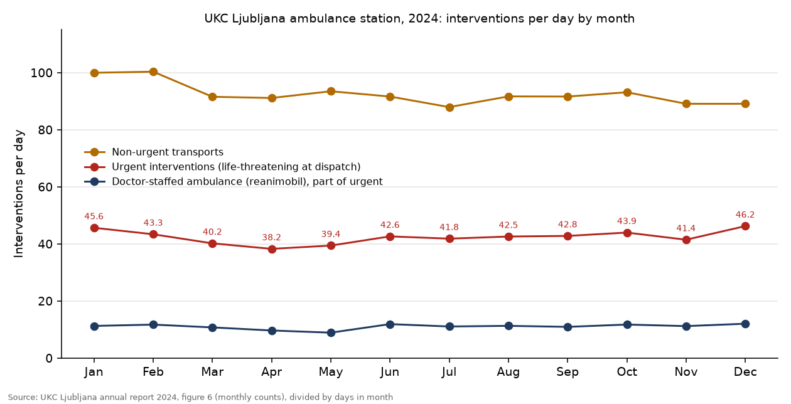

# Day-to-day operations: totals, seasons, fuel, breaks, cleaning, handover

Answers to practical questions about how the Ljubljana ambulance station really works. Companion to [LJUBLJANA_FLEET_AND_TEAMS.md](LJUBLJANA_FLEET_AND_TEAMS.md), [GAPS_STATUS.md](GAPS_STATUS.md) and [SCENARIO_DATA.md](SCENARIO_DATA.md). Researched 2026-11-21.

**Tags:** **[S]** read in the original document; **[SS]** only seen in a web-search summary; **[I]** my inference or arithmetic from sourced numbers; **[A]** an assumption (no source); **[?]** not found.

---

## 1. Why the "total number of interventions" is different every time

The total is **two very different things added together**:

| Year | Urgent interventions (life-threatening when the team left) | Non-urgent transports | Total | Source |
|---|---|---|---|---|
| 2024 | 15,497 | 33,855 | **49,352** | UKC annual report 2024, figure 5 [S] |
| 2025 | 16,087 | 32,667 | **48,754** | UKC annual report 2025, figure 5 [S] |
| Change | **+3.8 percent** | **-3.5 percent** | -1.2 percent | [I] |

- **Non-urgent transports** are two thirds of the total: patients going to dialysis, clinics, discharge and so on. They are not emergencies.
- **Only about a third (31 percent in 2024, 33 percent in 2025) are urgent**, meaning a life threat was found when the team set off.
- The report also lists smaller groups that are **parts of these two**, not extra: doctor-staffed ambulance (reanimobil) 4,027 in 2024 and 3,737 in 2025; motorcycle 227 and 456; the two outposts (Ivančna Gorica 2,194, Vrhnika 1,549 in 2024); doctor transport for Ivančna Gorica 394 in 2024. They add up only if you treat them as parts: 15,497 + 33,855 = 49,352 exactly.
- The 2025 footnote says the total is built from dispatch-service data **plus the station's own data on non-urgent transports**, and includes the outposts.
- **The 2018 numbers look inconsistent because two pages of the same website count differently:** one page says 50,457 interventions with 26,340 "urgent", the other says 41,441 with 10,822 "urgent". The pages do not explain the difference, so I cannot tell which rule each uses. Use the 2024 and 2025 reports, which show the split.

**Rule of thumb for the scenario:** about 134 interventions a day in 2025, of which about 44 are urgent and 89 are non-urgent transports.

---

## 2. How interventions and severity spread through the year

Only **2024 has a monthly breakdown** in the sources I found. The numbers below are read from figure 6 of the 2024 report; I checked that the 36 monthly values add up exactly to the published annual totals (15,497, 33,855, 4,027).

| Month | Urgent | Per day | Non-urgent | Per day | Doctor-staffed (part of urgent) |
|---|---|---|---|---|---|
| Jan | 1,414 | 45.6 | 3,098 | 99.9 | 348 |
| Feb | 1,257 | 43.3 | 2,909 | 100.3 | 339 |
| Mar | 1,245 | 40.2 | 2,837 | 91.5 | 332 |
| Apr | 1,147 | **38.2** | 2,733 | 91.1 | 289 |
| May | 1,221 | 39.4 | 2,897 | 93.5 | 275 |
| Jun | 1,278 | 42.6 | 2,748 | 91.6 | 356 |
| Jul | 1,296 | 41.8 | 2,725 | **87.9** | 342 |
| Aug | 1,319 | 42.5 | 2,841 | 91.6 | 349 |
| Sep | 1,283 | 42.8 | 2,748 | 91.6 | 327 |
| Oct | 1,362 | 43.9 | 2,886 | 93.1 | 363 |
| Nov | 1,243 | 41.4 | 2,672 | 89.1 | 335 |
| Dec | **1,432** | **46.2** | 2,761 | 89.1 | 372 |

**What it shows [I]:**
- **The year is very flat.** Urgent cases range from 38 to 46 a day, a gap of 21 percent between the quietest month (April) and the busiest (December). Around the yearly mean it is about plus or minus 10 percent.
- **Winter is slightly busier** for urgent cases (Dec, Jan, Feb, plus Oct), and **spring is the quietest**.
- **Non-urgent transports are highest in January and February** (about 100 a day) and lowest in July.
- **The doctor-staffed share is steady at about 26 percent of urgent cases** (4,027 of 15,497 in 2024; 23 percent in 2025).

**Severity.** The published split is urgent against non-urgent, plus the doctor-staffed share. Within urgent, the priority colours are **not published** in anything I found. Two related facts [S]: the dispatch service says a doctor is actually needed in only **10 to 30 percent** of top-priority interventions, and in 2018 the station reported (of 41,441 interventions) chest pain 3,331, breathing difficulty 3,389, minor wounds or fractures 4,226, altered consciousness or paralysis 3,043, 999 road accidents, 337 deaths, 460 people who refused transport, 146 who left before arrival and 143 cancelled calls.

**Not found [?]:** time of day, day of the week, or any other seasonal pattern beyond the monthly 2024 chart. The statistics are not published in the dispatch service pages I read. Anything more detailed would need the station or the dispatch service.

---

## 3. How far an ambulance drives before refuelling

No source says when or where Slovenian ambulances refuel, or the real range. This is an estimate from tank size, consumption and kilometres driven.

| Item | Value | Basis |
|---|---|---|
| Fleet makes | Volkswagen, MAN and Mercedes-Benz based ambulances | 2026 maintenance tender lots [S] |
| Tank, Volkswagen Crafter | **75 L** | VW brochure and a database [SS] |
| Tank, MAN TGE | **75 L** (the TGE is a rebadged Crafter built in the same factory) | Auto Express [SS] |
| Tank, Mercedes Sprinter | **71 to 75 L** by variant (some builds 100 L) | builder and spec sites [SS] |
| Consumption | Sprinter 519 CDI **12.7 L per 100 km** (official combined cycle); a builder quotes 10 to 12; Crafter owner logs 9 to 10 | spec and owner records [SS] |
| Ambulance in city use | higher than the road-test figure because of stop-and-go, lights and idling | [I] |

**Estimate [I]:** take 10 to 14 L per 100 km. A full 75 L tank gives about **535 to 750 km**. If refuelling at a quarter of a tank (56 L usable, my assumption), that is about **400 to 560 km** between stops.

**How hard they are driven (kilometres) [S unless noted]:**
- **Ljubljana, 2018:** 787,255 km in the year, **32,802 km per vehicle**, which is about **90 km per day** averaged over the whole fleet including spares. A vehicle on a round-the-clock team drives more than this average **[I]**.
- **Comparable Slovenian unit, Koroška region, 2021:** the busiest ambulance drove **77,964 km** in a year (about 190 km on each active day) and the quietest 30,336 km; per active day the units drove **61 to 186 km**.

| Driving pattern | Fuel per day (at 12 L/100 km) | Refuel about every |
|---|---|---|
| Fleet average, 90 km/day | 11 L | 5 days |
| Koroška busiest, about 190 km/day | 23 L | 2 to 3 days |

This is for planning only: **refuel about every 2 to 5 days of duty, never mid-shift unless the tank is low [A]**. The dispatch rules do not list refuelling as a status; the crew only has to report a **longer unavailability and the reason** [S].

---

## 4. Breaks and rest for employees

**What the law says [S, Labour Relations Act ZDR-1, official text read]:**
- **Article 154:** a full-time worker has a **30-minute break during the day**. It **counts as working time**. It can be set only after one hour of work and no later than one hour before the end. For uneven or changed schedules the length is set **in proportion to the daily working time**.
- **Article 155:** **12 hours of uninterrupted rest in every 24 hours**; **11 hours** if working time is unevenly distributed.
- **Article 156:** **24 hours of uninterrupted weekly rest** in any seven days, as an average over 14 days.

**Applied to the Ljubljana pattern:**
- **12-hour day shift, then a 12-hour night shift on the next day, then 2 days off** [S, station website]. Day shift followed by the next day's night shift leaves about a full day between them, which fits the 12-hour rest rule.
- A **12-hour shift probably carries a longer break than 30 minutes** if the proportional rule is read literally: 30 minutes for 8 hours would be **45 minutes for 12** **[I]**. I did not find the employer's or the collective agreement's own figure.
- **Where the break is taken [S]:** crews normally wait for calls at the ambulance station, at the UKC emergency block or at an outpost, and **must be constantly reachable** so they can leave at once. So a break is taken **on standby, and a call can interrupt it** **[I]**. A Supreme Court order reported by a legal site found the 30-minute right is not violated just because no replacement was provided or because the break is taken at the workstation **[SS]**.
- **Not found [?]:** shift start times, a written break schedule, and any rule in the two EMS rulebooks about breaks (I searched both for the word and found none).

---

## 5. A patient bleeds heavily: how the ambulance is cleaned

**What the station says it does [S, ambulance station website]:**
1. **After every intervention** the crew cleans **all contact surfaces**: the stretcher, all work surfaces and every aid that was used.
2. If the patient had a pathogen that spreads through the air, a **steam disinfection (aerosolisation) with hydrogen peroxide** is also done.
3. After cleaning, the crew **orders and refills the consumables that were used or are missing**. Only then is the vehicle **ready for a new intervention**.
4. **At the end of the shift** they also clean the floor, wipe all contact surfaces with disinfectant, empty the bins and, if needed, wash the outside. The new crew then does a **handover check of the whole equipment set**, filled in on an **electronic form**.

**What I did not find [?]:** a **separate procedure or time for heavy blood contamination**, and **how long the vehicle stays out of service**. The station's published steps are the same for every patient, and the steam step is for airborne infections, not blood.

**What general guidance says [SS]:** remove gross contamination first with a disposable cloth, then disinfect with an approved product used as its label says; a diluted bleach solution (about 1:10 to 1:100) is common for blood; open the rear doors afterwards because about 10 minutes of ventilation gives one full air change. These are foreign or general sources, not Slovenian rules.

**Other facts that matter:**
- **No wash bay at the station [S, UKC annual report 2025]:** the building has no space or conditions for washing ambulances, so heavy washing happens elsewhere **[I]**.
- **Cleaning slows teams down [S, Koroška region report 2021]:** the report names disinfection after interventions as one cause of longer response times, alongside long hospital handovers.
- **Time for the scenario [A, no source]:** routine clean and restock **5 to 10 minutes**; a heavy blood contamination **30 to 45 minutes out of service**, including ventilation and restocking. Label both as assumptions on stage.
- **A reserve vehicle swaps in** if the vehicle must stay out longer; the rule is at least **20 percent spare vehicles per type** [S, NMP rulebook 2015, article 19; replaced on 3 June 2026, not re-verified], and a vehicle that breaks down must be replaced **within 2 hours at most** [S, dispatch rulebook 2017, article 22].

---

## 6. Handover, booking in and paperwork

**The chain of statuses the team sends to dispatch [S, dispatch rulebook 2017]:**

`SPREJETO` (accepted) → `NA POTI` (on the way) → `NA KRAJU` (at the scene) → `PRI PACIENTU` (with the patient) → `S KRAJA` (left the scene) → `NA CILJU` (at the hospital) → `PREDAJA PACIENTA` (patient handed over) → `PROST` (free)

**The time limits and duties [S, dispatch rulebook 2017]:**
- **Longest handover time: 15 minutes.** Right after handover the team reports **free**, or **the reason** if the handover took more than 15 minutes.
- If the dispatcher asks, and the patient's condition allows, the team **shortens the handover**, **provided the equipment and consumables still meet the minimum standard**.
- The team reports to dispatch, as things happen: acceptance, start, arrival at scene and at patient, departure, arrival at the destination, **hazards, extra resources needed, helicopter landing possibility, orders needed at the receiving hospital (pre-alert), the patient's condition, the patient's data (name and date of birth if unknown), a longer-than-set unavailability and why, and other information on request.**
- Dispatch measures **time of treatment** (call to handover) and **total intervention time** (call to free).

**What the rescuers hand over at the emergency department [S, station website]:**
- The patient's data for **administrative entry** into the hospital system (partly given already during transport).
- A **summary of the event**, the **leading problem**, the **urgent conditions recognised**, the **history and what others told them**, and the **vital signs during care**.

**Update, 21 Nov 2026 [SS]:** a new rulebook applies since 3 June 2026. Paperwork is now **one digital record per event**, patient data go to the central health record and must reach the hospital system at the latest at handover, rollout starts in Gorenjska in autumn 2026 and covers all units in 2027, and paper forms stay as the fallback. So Ljubljana probably still used the older process in 2026 **[I]**. Details in [DATA_FRESHNESS.md](DATA_FRESHNESS.md). The form list below is from the **2015** rulebook and may be partly replaced.

**The paperwork [S, NMP rulebook 2015, article 20]:**

| Document | Slovenian name | When |
|---|---|---|
| Emergency intervention protocol | protokol nujne intervencije | every emergency intervention |
| Intake of emergency interventions | sprejem nujnih intervencij | every emergency call |
| Resuscitation protocol | protokol oživljanja | when resuscitation is done |
| Ambulance transport report | poročilo o reševalnem prevozu | transports |
| Triage card | triažni karton | mass casualties |
| Motorcycle intervention report | poročilo o intervenciji ekipe motornega kolesa | motorcycle team |
| Refusal of care or transport | odklonitev zdravstvene oskrbe ali reševalnega prevoza | patient refuses |

- The helicopter service hands the **emergency intervention protocol (paper or digital) and the health insurance card** to the receiving team [S, helicopter service page]. For road crews the card and the protocol are the same documents in practice **[I]**.
- The protocol has a **handover section with times and a doctor's signature and stamp** **[SS]**.
- A **newer 2026 rulebook** is reported to require that **digital patient data is available in the receiving hospital's system at the latest by handover** **[SS]**.
- Teams also report to the Ministry every six months on their work [S].

**How long the whole thing takes [?]:** no Slovenian figure is published for booking-in and paperwork. What is known:
- The legal **maximum handover is 15 minutes**.
- **Comparison, Netherlands (one hospital, 2,967 arrivals) [SS]:** median offload delay **16 minutes** (middle half of cases 10 to 25 minutes). **England [SS]:** averages around 33 to 42 minutes, well above the 15-minute target.
- **Koroška region [S]:** from call to return to base the average team is away **60 to 169 minutes** depending on the unit; access time 11 to 19 minutes. The report blames long hospital handovers for some of the longer access times.
- **For the scenario [A]:** handover **10 to 15 minutes**, cleaning and restock **5 to 10 more**, so a team is back in service about **15 to 25 minutes after arriving at the hospital**.

---

## 7. Summary of what the scenario now uses

| Parameter | Value | Tag |
|---|---|---|
| Max handover time | 15 min | [S] |
| Status chain | 8 statuses above | [S] |
| Replacement vehicle after breakdown | within 2 h | [S] |
| Spare vehicles | at least 20 percent per type | [S] |
| Hospital capacity report | within 15 min | [S] |
| Break | 30 min counted as work; 45 min for a 12 h shift (inference) | [S] / [I] |
| Daily rest | 12 h | [S] |
| Tank | 75 L | [SS] |
| Consumption | 10 to 14 L per 100 km | [SS] / [I] |
| Refuelling | about every 2 to 5 days | [I] |
| Cleaning after a job | 5 to 10 min | [A] |
| Cleaning after heavy bleeding | 30 to 45 min | [A] |
| Urgent per day | 38 to 46 by month | [S] |
| Non-urgent per day | 88 to 100 by month | [S] |

---

## 8. Sources

All accessed 2026-11-21.

- UKC Ljubljana annual report 2024, figures 5 and 6 (read in full): https://www.kclj.si/dokumenti/Letno_porocilo_UKC_Ljubljana_za_leto_2024_net.pdf
- UKC Ljubljana annual report 2025, figure 5 and section 4.8.5 (read in full): https://www.kclj.si/dokumenti/LetnoPorociloUKCL_2025.pdf
- Ambulance station, shifts, handover, cleaning procedure (read in full): https://rpukclj.si/storitve/res-sluzba/
- UKC Ljubljana, 2018 interventions page: https://www.kclj.si/index.php?dir=%2Fpacienti_in_obiskovalci%2Fklinike_in_oddelki%2Fresevalna_postaja%2Fintervencije_
- UKC Ljubljana, ambulance station page (2018 fleet and figures): https://www.kclj.si/index.php?dir=/pacienti_in_obiskovalci/klinike_in_oddelki/resevalna_postaja
- Pravilnik o dispečerski službi zdravstva, Uradni list RS 58/2017, articles 22 and the annex on quality indicators (read in full, gazette PDF): https://pisrs.si/api/uradni-list/objava/u2017058.pdf
- Pravilnik o službi nujne medicinske pomoči, Uradni list RS 81/2015, articles 19 and 20 and the job profiles (read in full, gazette PDF): https://pisrs.si/api/uradni-list/objava/u2015081.pdf
- Zakon o delovnih razmerjih ZDR-1, Uradni list RS 21/2013, articles 154 to 156 (read in full, gazette PDF): https://pisrs.si/api/uradni-list/objava/u2013021.pdf
- Zdravstveno reševalni center Koroške, annual report 2021 (kilometres, access and absence times): https://zrck.si/wp-content/uploads/2025/07/LP2021.pdf
- Helicopter service, handover and documents: https://www.hnmp.info/aktivacija/varnost-predaja-pacienta-dokumentacije/
- Ministry of Health, dispatch plan 2022 (doctor needed in 10 to 30 percent): https://www.gov.si/assets/ministrstva/MZ/DOKUMENTI/ZDRAVJE/organiziranost/Nacrt-vzpostavitve-Dispecerske-sluzbe-zdravstva.pdf
- TED notice, fleet maintenance lots (vehicle makes): https://ted.europa.eu/en/notice/304264-2026/pdf
- Mercedes Sprinter 519 CDI specifications: https://www.ultimatespecs.com/car-specs/Mercedes-Benz/135240/Mercedes-Benz-Sprinter-2019-L2H1-RWD-519-CDI-50t.html
- Sprinter ambulance tank and consumption (builder): https://ambulancetech.com/mercedes-benz-ambulance/
- VW Crafter brochure, 75 L tank: https://www.vw.co.za/idhub/content/dam/onehub_pkw/importers/za/brochures/cv/61589%20VW%20MY24%20Brochure%20Updates%20Crafter%202023_31%20JULY%20(1).pdf
- Auto Express, MAN TGE: https://Autoexpress.co.uk/man/tge
- ASPR TRACIE, EMS infectious disease transport playbook (general decontamination guidance): https://asprtracie.hhs.gov/documents/aspr-tracie-transport-playbook-508.pdf
- WAITED study, ambulance offload times in a Dutch hospital: https://pmc.ncbi.nlm.nih.gov/articles/PMC12661773/
- Healthcare in Europe, ambulance handover delays in England: https://healthcare-in-europe.com/en/news/severe-impact-ambulance-handover-delays-uk-nhs.html
- IUS-INFO, Supreme Court order on breaks in 12-hour shifts: https://www.iusinfo.si/medijsko-sredisce/v-srediscu/294925
