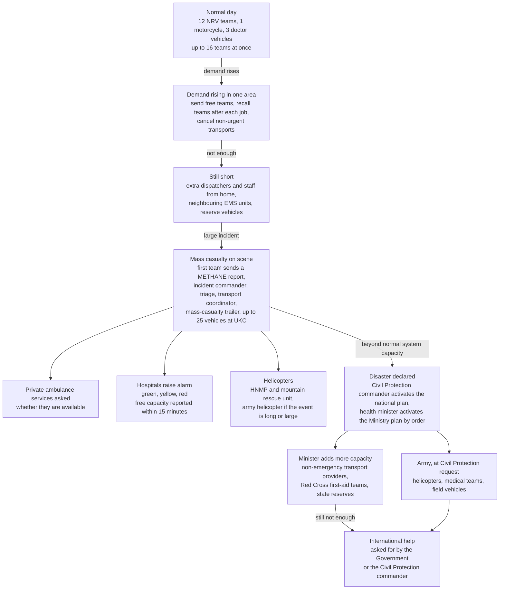
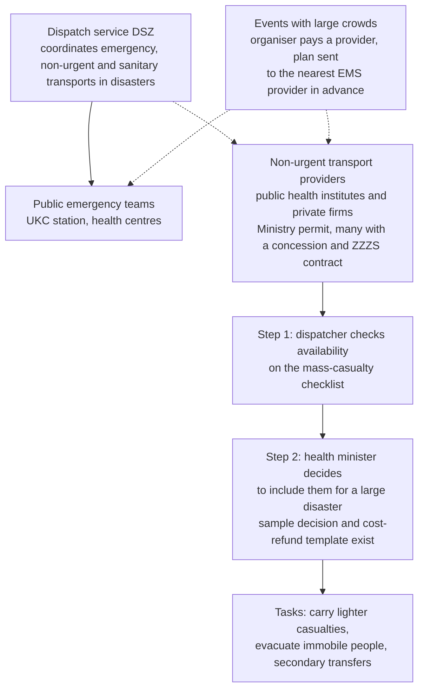
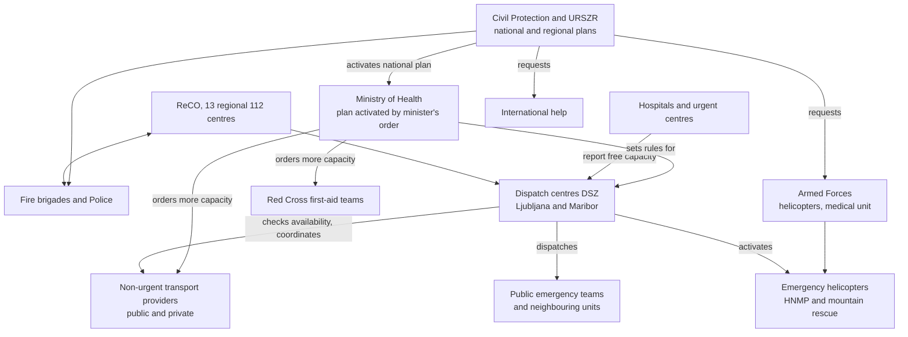

# Surge capacity and multi-service coordination (Ljubljana / Slovenia)

What happens when demand is higher than normal: a big event, several incidents at once, or a raised threat level. Who else can be brought in (private ambulances, Red Cross, army, other regions, other countries), who decides, and what data moves between them.

Companion to [LJUBLJANA_FLEET_AND_TEAMS.md](LJUBLJANA_FLEET_AND_TEAMS.md), [EMS_RESEARCH.md](EMS_RESEARCH.md) and [WORKFLOWS.md](WORKFLOWS.md). Researched 2026-11-21.

**Tags:** **[S]** stated in a source I read in full; **[SS]** only seen in a web-search summary, not confirmed in the original text; **[I]** my inference; **[?]** not found.

**Source ages matter.** The mass-casualty guideline is from **March 2013** and was written before the central dispatch centres existed. The Ministry of Health disaster plan is dated **24 Nov 2025** and is current. The dispatch-service plan is from Nov 2022. Where the 2013 text describes something "to be set up in future", I say so.

---

## 1. Short answers

| Question | Answer | Tag |
|---|---|---|
| How do the numbers change in a surge? | A normal day uses up to **16** teams at once at the UKC station; in an emergency it can activate up to **25 vehicles** with trained crews (about 56 percent more). Beyond that it relies on outside help | [S] |
| Are private ambulances part of this? | Yes, at a second tier. Private (and public) **non-urgent transport providers** are called by the dispatcher to check availability, and in a large disaster the **health minister can formally bring them in** by decision, with a template for cost reimbursement. They are not part of the normal emergency teams | [S] |
| Does the army have ambulances that join? | I found **no standing military ambulance fleet that joins civil EMS**. What the sources show is **army helicopters** (flying emergency and inter-hospital missions every year), a military medical unit and a mobile field hospital that can help **when Civil Protection requests it** | [S] helicopters, [SS] the rest |
| How are several events at once handled? | Through the central dispatch centres: neighbouring EMS units fill gaps, free teams are recalled, non-urgent work is cancelled, and a hospital "distribution key" spreads patients. A regional health coordination group, written into the 2017 dispatch rulebook, is formed in the dispatch centre to run it. No numeric trigger or automatic re-allocation algorithm is published | [S] / [?] |
| What changes at a higher threat level? | The Ministry of Health's plan is switched on **by the health minister's order** after the Civil Protection commander activates the national plan. Extra staff are called in, elective surgery is released, neighbouring institutions help | [S] |

---

## 2. The escalation ladder

| Level | Trigger | Who decides | What is added | Tag |
|---|---|---|---|---|
| Busy day | More calls than free teams | Dispatcher | Teams recalled as soon as they finish; **non-urgent transports cancelled**; neighbouring EMS units called in a set order | [S] |
| Mass casualty | First team judges the event is mass-casualty and reports it (METHANE report) | First team's doctor or leader; dispatcher alerts all services | Incident commander, triage, transport coordinator; mass-casualty **trailer**; extra dispatchers from home; up to 25 vehicles | [S] |
| Hospital reaction | Notice of a mass casualty | Hospital command group | Green, yellow or red alarm (see 4) | [S] |
| Disaster | Event exceeds what the normal health system can handle | Civil Protection commander (national plan), then health minister (Ministry plan, by order) | Everything below | [S] |
| Extended resources | Needs rise further | Health minister | Non-emergency transport providers, Red Cross first-aid teams, state commodity reserves | [S] |
| Army | Civil Protection request | Civil Protection / URSZR; Ministry of Defence plan **"Vihra"** was used in the 2023 floods | Helicopters, medical teams, field vehicles | [S] plan name, [SS] detail |
| International | Domestic capacity is not enough | Government or Civil Protection commander; the Ministry of Health collects needs (vehicles, teams, staff, equipment) | Foreign teams and equipment; cross-border agreements exist between institutions | [S] |

**What the Ministry of Health plan covers [S, 24 Nov 2025]:** earthquake, flood, fire, nuclear and radiological accidents, epidemic or pandemic, dangerous animal diseases, major air, sea and rail accidents, and attacks with weapons or mass-destruction means by terrorists using conventional means. The plan is switched on only when the national plan has been activated and the event involves health.

**Example of "threat level" tiers in the plan (earthquake) [S]:**
- Up to intensity V (felt, no damage): national and Ministry plans **not** activated; normal capacity is enough.
- Intensity VI or VII (damage to buildings): Ministry plan **may** be activated; extra staff called in, reserve staff, release of part of elective surgery, help from neighbouring institutions.
- Intensity VIII or higher (injuries, collapses): national plan and Ministry plan are activated **immediately**.
Other event types follow similar tiers (floods, fire, nuclear). No threat-level scheme for "increased risk without an event" was found.

---

## 3. The numbers, normal versus surge

| Item | Normal | Surge | Source / tag |
|---|---|---|---|
| UKC Ljubljana teams working at once | up to 16 (of different profiles) | up to **25 vehicles** with trained crews in an emergency | UKC annual report 2024 [S] |
| Patients per emergency ambulance | one main patient | rough planning figure: **2 serious + 2 lighter** | MCI guideline 2013 [S] |
| Patients per non-emergency ambulance | one | **1 serious + 1 lighter** | MCI guideline 2013 [S] |
| Helicopters | HNMP at Brnik, activation about 10 min; mountain rescue unit at Brnik June to Oct about 15 min, otherwise about 1 h | All helicopters available for emergency medical work may be used, but **extra aircraft fly only if extra crews are provided** | MCI guideline 2013 [S] |
| Army helicopter | n/a | Checked for long or large events through ReCO | MCI guideline 2013 [S] |
| Hospital free-capacity report | on request | **within 15 minutes** of the notice, then forecasts for +1 h and +2 h at yellow and red alarm | MCI guideline 2013 [S] |
| Mass-casualty trailers | n/a | 7 regional trailers: Celje, Murska Sobota, Koper, Novo mesto, Kranj, Nova Gorica, **Ljubljana**; the fire brigade brings it, the EMS unit supplies medical items | Ministry plan 2025 [S] |
| Definition of mass casualty (motorway regional plan) | n/a | more than **10** dead or seriously injured | [SS] |
| Dispatch service reach | 79 percent of the national population in 2024 | coordinates **110** teams nationally | UKC annual report 2024 [S] |

**Rule of thumb for the scenario [I]:** with 12 NRV teams on a normal day, 25 vehicles in an emergency is roughly double. Combine with the 2 + 2 patient estimate and one NRV can move about four casualties per trip.

---

## 4. Inside a mass-casualty response

**On scene [S, 2013 guideline]:**
- The **first EMS team** reports to the dispatcher or ReCO using the METHANE format, sizes up the event, takes the lead of the medical intervention and starts primary triage. Roles can be combined in one person until enough rescuers arrive.
- Roles: NMP incident commander, primary-triage lead, **transport coordinator**, treatment-site lead, sector leads (red, yellow, green), logistics lead, traffic lead. A transport coordinator and the dispatch service keep a log of every vehicle and patient that leaves.
- Triage: primary triage on scene, then secondary triage, then **transport triage**. Transport order depends on injuries and treatment so far, urgency of surgery, vehicle type, need for an escort, and the right target hospital. Factors for transport triage: vehicles available, and hospital capacity by specialty.
- Layout: a ring road for ambulances, an assembly point for ambulances, a patient loading point, a helicopter landing site at a safe distance, and an outer security cordon. Fire, police and Civil Protection or Red Cross staff may take over triage and recording.
- **Dispatcher checklist [S]** (in order): notify ReCO; send free teams of your own unit (first team brings the mass-casualty kit); call extra dispatchers from home; call neighbouring EMS units in the agreed order; alert the main receiving hospital; ask teams already driving to report as soon as they finish and cancel further non-urgent transports; alert the head of the unit and of the ambulance station; **activate the mass-casualty trailer**; **ask private ambulance services whether they are available**; call extra staff from home.
- **Communication [S]:** first by mobile or direct radio between the incident commander and the hospital's supervising doctor; if several hospitals are involved, the hospital supervisor and then the enlarged **hospital command group (BPS)** of the main receiving hospital pool free-capacity data and make a **distribution key** (how many patients, how severe, which type of injury each hospital can take). Ambulance drivers report the injury type and expected arrival to the receiving hospital through the dispatcher. If direct links fail, communicate through ReCO.
- **Regional health coordination group [S, planned in 2013]:** to be formed inside the dispatch centre. It collects information from the field and hospitals, passes it to the commander, the transport coordinator and hospital supervisors, talks to the army, Civil Protection, Red Cross and mountain rescue, and **activates rescue services outside the EMS system to get extra vehicles**. Until it exists, the enlarged hospital command group does part of this. **Update:** it is written into the 2017 dispatch rulebook (article 21): in a special event the competent dispatch centre forms it, with **at least two health dispatchers and a consultant doctor**. It can **declare a mass casualty** (level 1 on its own; levels 2 to 4 under the Ministry guideline), and its tasks include **activating health rescue services that are outside both the EMS network and the non-urgent transport network, to provide extra teams and vehicles** **[S]**. Whether it has been used in practice: **[?]**.
- **Secondary transports [S]:** after the first wave, transports move patients from hospitals near the event to hospitals further away, both to give better care and to free beds; equipment and staff also move to overloaded hospitals.

**In the hospital [S]:** at the first (green) level the hospital command group is activated and key posts are told; at yellow (partial mobilisation) also unstarted elective procedures are "frozen" and extra staff are called from home; at red (full mobilisation) all urgent and support staff are called in. The report of free capacity covers: patients accepted at once by triage category and injury type, free operating rooms, free intensive-care beds, free ventilators, normal beds, and special capabilities such as burns or neurotrauma. The scheme follows the MACSIM method recommended by the European trauma society.

---

## 5. Private ambulances

- **Who they are [S / SS]:** an emergency-transport provider is a public health institute or a person holding a concession; non-urgent transport also needs a Ministry of Health permit. One undated report counted 62 providers in the public network, 43 public institutes and 19 private firms, with 28 more holding permits only **[SS]**. I found no list or count for the Ljubljana area. A concession without a ZZZS contract can only charge patients directly **[SS]**.
- **Since 3 June 2026 (new rulebook) [SS, Ministry statement and Žurnal24]:** non-urgent providers in the public network **must answer the dispatcher's call and join emergency operations during a sudden, short-term rise in demand**. A non-urgent ambulance provider needs a **Ministry permit, staff for at least two teams, at least two ambulances and a replacement vehicle**; a sanitary-transport provider needs one trained driver, one sanitary vehicle and one spare. Providers outside the emergency network must mark vehicles "Prevoz pacientov". In a disaster, the minister's measure plus a dispatch call can bring in public-network non-urgent providers.
- **How they are used in a surge [S]:**
  - The 2013 guideline says transport providers "public or private" help with moving people **when the EMS system calls on them**, and puts "ask private ambulance services whether they are available" on the dispatcher checklist.
  - The 2025 Ministry plan lets the minister, by decision, **include non-emergency transport providers** and Red Cross first-aid teams. Sample documents exist for the decision to include them temporarily and for **refunding their costs** (plan annexes 13 and 14), and there is a rulebook on cost refunds and inclusion.
  - In the plan, non-emergency providers are **activated through the dispatch service DSZ** to evacuate people who cannot walk, with the sick, elderly, disabled and convalescent evacuated first.
  - The DSZ rulebook already covers non-emergency teams: DSZ is to monitor and coordinate "teams of non-urgent transport providers" along with emergency teams **[S]**.
- **Events with many people [SS]:** the organiser must arrange and pay for medical cover by a written agreement and notify the nearest EMS provider at least **15 days** before (older 2015 text). A newer rulebook text reported for 2026 says very demanding and risky events can only be covered by a **public** health institute with a permit. Private firms also advertise event cover. For state-protocol events the UKC station provides cover itself **[S]**. This is the "hiring" part: the organiser pays; it is not a surge tool.
- **Governance concerns [SS]:** a parliamentary committee flagged permit holders that subcontract to concession holders who then bill the insurer as if they had done the trips, and a reform to the health-activity law was in progress. Current status not confirmed.
- **Not found [?]:** hourly rates or hire contracts for ambulances in a surge, response lead times of private providers, and which firms are in the Ljubljana area.

---

## 6. The army

- **Helicopters [S]:** army helicopters fly the helicopter EMS whenever the police aircraft or crew are unavailable. A June 2024 government decision moves this to the police over time (see EMS_RESEARCH.md). In 2024 military helicopters flew **565 inter-hospital transfers** with health institutions **[SS, army news]**.
- **Activation [S / SS]:** the army acts when Civil Protection requests it. In the August 2023 floods the Ministry of Defence plan **"Vihra"** was activated by the national protection and rescue administration (URSZR), and the army worked from requests by Civil Protection services **[SS]**. In those floods on average five army helicopters flew each day from 4 to 16 August, 212 flying hours, 510 people and 152 tonnes of cargo, and 42 helicopter EMS missions **[SS]**.
- **Medical unit [SS]:** the army's Military Health Unit can assist civilians after disasters when Civil Protection activates it, and has a mobile field hospital (Role 2) able to give emergency surgery when hospitals are overwhelmed. I did not confirm the size, readiness or activation time of either.
- **In the EMS guideline [S]:** the regional health coordination group is to talk to the army, and for long or large incidents the NMP incident commander asks, through ReCO, whether an army helicopter can be activated. A person from the Ministry of Defence took part in writing the guideline.
- **Organ flights [S]:** the army's Falcon jet carries organs for transplants.
- **Ambulances [?]:** I found **no evidence of a standing military ambulance fleet** that civil dispatch can call on. Treat "army ambulances join the pool" as unconfirmed; the documented military contributions are helicopters, medical personnel and field facilities, on Civil Protection request.

---

## 7. Other services that join

| Service | Role | Tag |
|---|---|---|
| ReCO (13 regional 112 centres) | Alerts fire and police in parallel; passes information between scene and hospitals when direct links fail; **activates the trailer and helicopters** | [S] |
| Fire brigades | Rescue, bring and look after the mass-casualty trailer, secure helicopter landing sites | [S] |
| Police | Scene security, crowd control, traffic, landing-site security | [S] |
| Civil Protection and URSZR | Owns the national and regional plans; the commander activates the national plan and triggers the Ministry of Health plan; can take over triage and patient recording with Red Cross | [S] |
| Red Cross Slovenia | First-aid teams and material resources, added by the minister's decision; triage and recording help | [S] |
| Mountain rescue association (GRZS) | Winch rescue helicopter unit | [S] |
| Hospitals | Alarm levels; free-capacity reporting; staff call-in; hospital command group | [S] |
| Neighbouring EMS units | Called in the order set for each unit | [S] |
| Other countries | Cross-border agreements between institutions; aid via Government / Civil Protection commander | [S] |

---

## 8. Several events at once, or a general rise in emergencies

What the sources actually say:

- **One dispatch picture [S]:** from 2018 the two dispatch centres coordinate all mobile emergency teams, the helicopter teams and (planned) non-urgent providers, and keep a record of hospital capacities. They arrange mobile units so that **access time is as even as possible** across the territory, and in a disaster DSZ "assigns and coordinates urgent, non-urgent and sanitary transports", looks after "optimal use of resources", and reports to the Ministry's contact point.
- **Since 3 June 2026 [SS]:** dispatch assigns by the **shortest access time regardless of which provider's area** the incident is in (before, out-of-area help was the exception); dislocated units such as Ivančna Gorica, Vrhnika and **now Medvode** reduce gaps; first responders can be activated through dispatch. See [DATA_FRESHNESS.md](DATA_FRESHNESS.md).
- **Gap filling [S]:** a team from a neighbouring health centre may be sent if it is faster; neighbouring units are called in a set order; a busy unit may call a neighbouring unit or the helicopter.
- **Relieving the load [S]:** the dispatch service wants to move away from doctors accompanying every patient (a doctor is needed in only 10 to 30 percent of top-priority interventions), so doctor capacity is kept free for the next top-priority call.
- **Weak points named by the dispatch service itself [S, 2022]:** teams not where the contract says; crews not logged in or sending wrong status messages; reserve-vehicle quota not met; ageing fleets; the state radio network not fully working, so a phone app is the backup. These worsen in a surge.
- **Helicopters across events [S]:** all available helicopters can be used in a big event, but extra aircraft fly only if extra crews are provided; ReCO and CORS (the source does not spell out the acronym) do what is needed. Helicopters are day-only and weather-dependent, so a night or fog event has **no** helicopter option.
- **Pandemic type events [S]:** covered by separate plans (not read).
- **Not found [?]:** a published numeric trigger such as "when more than N calls are waiting, do X"; an automatic re-allocation algorithm; how a second simultaneous incident is prioritised against the first; whether the regional coordination group (article 21 of the 2017 dispatch rulebook) has been used in practice; and a scheme for a raised threat level without an event.

---

## 9. What this means for the challenge

- **Capacity tiers to model [I]:** Tier 0 own teams (12 NRV, 1 motorcycle, 3 doctor vehicles, up to 16 at once). Tier 1 recall teams, cancel non-urgent work. Tier 2 neighbouring units and reserve vehicles (the reserve is at least 20 percent per type **[SS]**). Tier 3 up to 25 vehicles at the UKC station. Tier 4 private non-urgent providers on request. Tier 5 minister's decision adds non-urgent providers and Red Cross. Tier 6 army and international. Each tier has an **activation authority** and a **lead time**; the lead times are mostly **unknown**, so they are scenario assumptions.
- **Realistic events for "chaos":** shortage of vehicles (the challenge lists it), mass-casualty on a motorway, a hospital going on alarm (reduced capacity), helicopter grounded by fog or darkness, a second incident while teams are busy, radio failure with phone backup.
- **Data a surge replan needs:** live team pool (position, status, type), hospital free capacity (patients by triage category, operating rooms, ICU beds, ventilators, **within 15 minutes**), road closures and traffic, helicopter availability (daylight, weather, crew), patient priority and number, and a **distribution key** per hospital.
- **Plan quality hint [I]:** the real system aims for even access time over the whole area, not only for the incident; a good repair should not strip all teams from the rest of the city.

---

## 10. Sources

All accessed 2026-11-21.

- Ministry of Health, Smernice za delovanje sistema nujne medicinske pomoči ob množičnih nesrečah, March 2013 (read in full): https://www.szd.si/wp-content/uploads/2018/11/szd-uzvn-mrmi-smernice-za-delovanje-sistema-nmp-ob-mnozicnih-nesrecah.pdf
- Ministry of Health, Načrt dejavnosti Ministrstva za zdravje ob naravnih in drugih nesrečah, 24 Nov 2025 (read in full): https://www.gov.si/assets/ministrstva/MZ/DOKUMENTI/1-TEME/Nacrt-dejavnosti-Ministrstva-za-zdravje-ob-naravnih-in-drugih-nesrecah-v-Republiki-Sloveniji.pdf
- Dispatch service, Načrt vzpostavitve Dispečerske službe zdravstva, 21 Nov 2022 (read in full): https://www.gov.si/assets/ministrstva/MZ/DOKUMENTI/ZDRAVJE/organiziranost/Nacrt-vzpostavitve-Dispecerske-sluzbe-zdravstva.pdf
- UKC Ljubljana annual report 2024 (section 8.5): https://www.kclj.si/dokumenti/Letno_porocilo_UKC_Ljubljana_za_leto_2024_net.pdf
- Information Commissioner opinion quoting the dispatch rulebook: https://www.ip-rs.si/mnenja-gdpr/6048a38d4323f
- Slovenian Armed Forces, course on health measures in large disasters: https://www.slovenskavojska.si/medijsko-sredisce/novica/koncan-tecaj-ukrepov-zdravstva-ob-velikih-nesrecah/
- Slovenian Armed Forces, aviation in 2024: https://www.slovenskavojska.si/medijsko-sredisce/novica/letalstvo-slovenske-vojske-v-letu-2024-izkazalo-izjemno-podporo-pri-resevalnih-akcijah/
- Slovenian Armed Forces, flood recovery (plan "Vihra"): https://www.slovenskavojska.si/medijsko-sredisce/novica/slovenska-vojska-ostaja-dejavna-pri-sanaciji-okolja-neurij-in-poplav/
- Slovenian Armed Forces, 2023 floods: https://www.slovenskavojska.si/medijsko-sredisce/dogodki-1-1/
- RTV SLO, possible abuses in non-urgent ambulance transports: https://www.rtvslo.si/slovenija/odbor-dz-ja-zlorabe-pri-izvajanju-nenujnih-resevalnih-prevozov/699695
- N1, coalition proposal on contracts with private carriers: https://n1info.si/novice/slovenija/koalicija-predlagala-moznost-podaljsanja-pogodb-zdravstvenih-zavodov-z-zasebnimi-prevozniki
- Pravilnik o službi nujne medicinske pomoči in prevozih pacientov (event cover chapter; seen via search summaries only): https://pisrs.si/Pis.web/pregledPredpisa?id=PRAV15756
- OZG Kranj, event medical cover: https://www.ozg-kranj.si/za-paciente/zagotavljanje-zdravstvenega-varstva-na-prireditvah/
- Regional plan for mass accident on a motorway (definition of mass casualty): https://www.gov.si/assets/organi-v-sestavi/URSZR/Izpostava-Postojna/Regijski-nacrti-zascite-in-resevanja/Regijski-nacrt-zascite-in-resevanja-ob-mnozicni-nesreci-na-avtocesti.pdf
- Zakon o varstvu pred naravnimi in drugimi nesrečami: https://pisrs.si/Pis.web/pregledPredpisa?id=ZAKO364
