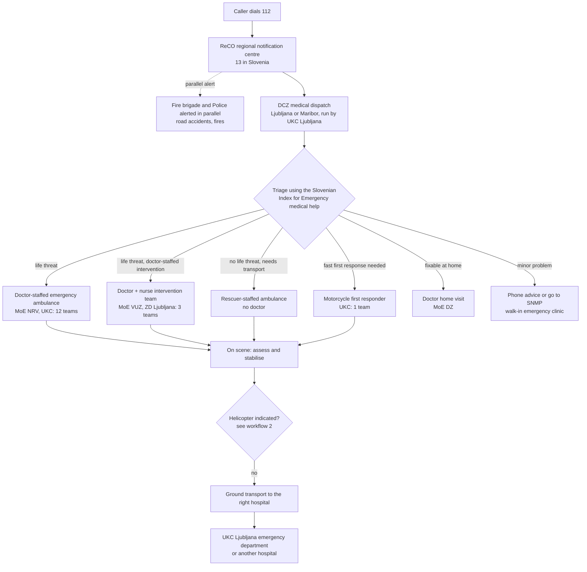
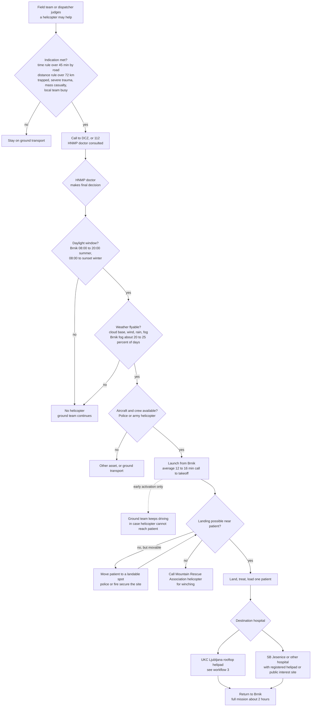
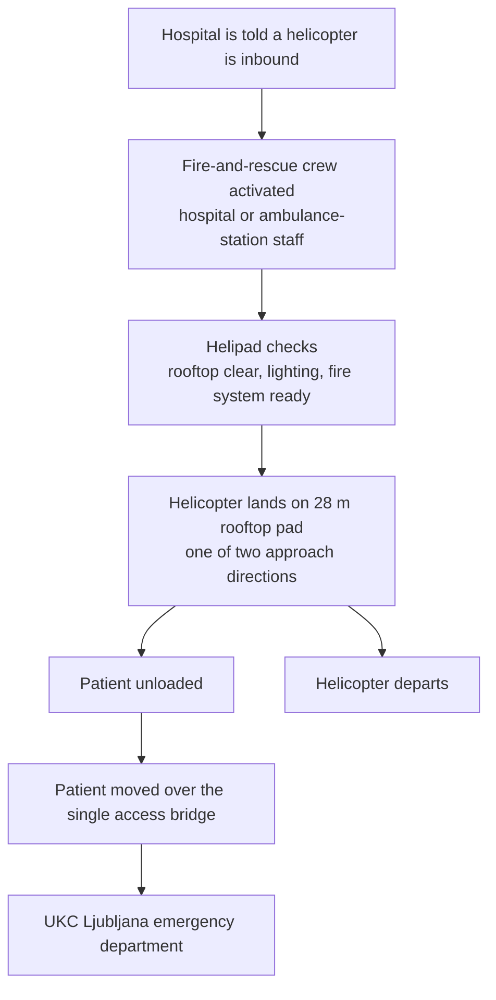
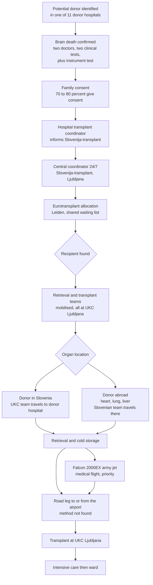
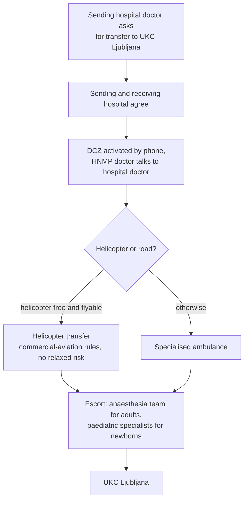
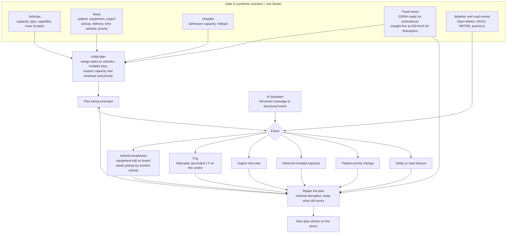

# EMS workflows: steps, data inputs, dependencies

Companion to [EMS_RESEARCH.md](EMS_RESEARCH.md) (the findings and sources). Written 2026-11-21.
Diagrams are Mermaid and render on GitHub and in most Markdown viewers. PNG copies of each diagram are in `docs/diagrams/` (numbered 1 to 6 to match the sections below), for slides or viewers that do not render Mermaid.

**Confidence tags** used in every table:
- **[S]** stated in a source I read (see EMS_RESEARCH.md for which one)
- **[I]** my inference from sources, not stated outright
- **[?]** not found; treat as unknown and ask a domain expert or the challenge mentors

Source age matters. The helicopter activation rules are from **2013** (archived), the EMS-system slides are about **2016-17**, the HNMP history is **2007**. Where a newer source disagrees, the newer one wins and the conflict is noted.

---

## 1. Emergency call to ground response (Ljubljana area)

| Step | Inputs (data needed) | Depends on | Output | Tag |
|---|---|---|---|---|
| Caller dials 112 | Caller's phone location (cell or e-call) | Mobile network | Call routed to the regional centre | [S] |
| ReCO regional centre | Caller location and spoken description | 13 regional centres; road-accident rule: alerts fire and police at the same time | Call passed to DCZ; parallel alerts | [S] |
| DCZ medical dispatch | Address, symptoms, caller answers to key questions | Law: Pravilnik o dispečerski službi zdravstva (OJ 58/2017); only some regions have joined so far | Urgency category and chosen team | [S] |
| Triage | Answers mapped to the Slovenian Index for Emergency medical help (based on the Norwegian index) | Index protocol | Response type: doctor team, rescuer ambulance, home visit, advice | [S] |
| Pick the team | Which units are free and where they are | Unit status. Live GPS is **not confirmed**. Sources only say the nearest suitable team is sent and one screen lists the nearest responders | Dispatched unit | [S]/[?] for GPS |
| Team drives to scene | Origin, destination, road network, traffic, closures | Routing method is **unknown**. Vehicles use sirens and form a rescue corridor | Arrival time | [?] |
| On scene | Patient condition, access, hazards | Team skills (doctor vs rescuer) | Treat on site, or decide to transport or call a helicopter | [S] |
| Transport to hospital | Right hospital = one that can finally treat this condition (for example heart attack needs a cath lab, severe head injury needs a neurosurgeon) | Hospital capability and capacity; hospital admission agreement | Patient handed over at the emergency department | [S] |

**Sizing numbers (use as plan inputs):**
- UKC Ljubljana plans 12 NRV teams + 1 motorcycle team [S, ZZZS decree 2026]
- ZD Ljubljana plans 3 VUZ teams + 1 home-visit team + on-duty and triage teams [S]
- Access-time target is 15 minutes; one emergency transport team per 30,000 insured people [S, about 2016]
- Ljubljana ambulance station: about 45,000 interventions a year, about 1,700 km², 3 motorcycles [S, 2019]

---

## 2. Helicopter (HNMP) activation and mission

| Step | Inputs | Depends on | Output | Tag |
|---|---|---|---|---|
| Indication check | Estimated road time to the right hospital, distance, injury type, whether patient is trapped, casualty count, whether local team is busy | Where the patient is; which hospital can treat them | Yes or no for a helicopter | [S, 2013 rules] |
| Activation | Location, condition, weather description from the field doctor | Route is 112 or DCZ. Since the plan of 15 Oct 2022, it runs in parallel with ambulances, fire and police. Older (2013) rules said the field doctor activates only after arriving | HNMP doctor's go or no-go | [S] |
| Daylight window | Date, Ljubljana sunrise and sunset | Published schedule; no night flying for HNMP found | Allowed or not | [S] |
| Weather check | Cloud base, wind, rain, visibility. Field doctor is asked to report them | Brnik sits in the Ljubljana basin and has frequent autumn and winter fog; Lesce proposed as a better site | Pilot's go or no-go | [S] |
| Aircraft availability | Which police or army helicopter and crew are free | Aircraft are shared with police and army duties; the new dedicated pair arrives Oct 2027 and Feb 2028 | Assigned aircraft | [S] |
| Launch | Crew on standby at the base | Base layout adds delay: crew rooms are about 250 m from the helicopter at Brnik | Takeoff. Average call to takeoff was 15, 15, 12, 16, 13 min in 2021 to 2025 | [S] |
| Flight to scene | Straight-line distance, wind | Typical rings are 5 to 30 min of flight around Brnik. The 2013 rules show them as a map | Arrival | [S] |
| Landing check | Free area, obstacles, safe distance, someone to secure it | Terrain. HEMS may land at unplanned sites under relaxed performance rules, with special approval and more experienced crews | Land, or move patient, or winch | [S] |
| Treat and load | Patient condition | One patient per aircraft; crew is doctor + nurse or technician + pilot + rescuer | Patient on board | [S] |
| Destination | Which hospital can finally treat | Helipad type and availability | Handover | [S] |
| Mission total | | | About 1 h 57 min average from call to return in the 2003-06 pilot | [S, old] |

**Volume:** Brnik flew 324 / 310 / 333 / 333 / 344 missions in 2021 to 2025 [S].
Conflicting figure to watch: the 2013 rules say average activation is **10 min**, the 2007 history says **17 min**, recent site data says **12 to 16 min**. Use the recent range.

---

## 3. UKC Ljubljana rooftop helipad (LJHL): arrival and handover

| Step | Inputs | Depends on | Output | Tag |
|---|---|---|---|---|
| Hospital notified | Estimated arrival time and patient details | Dispatch or the helicopter doctor | Alert to the crew | [S] |
| Crew activated | Roster of trained staff | These people have other jobs, so someone must be free | Helipad safe to use | [S] |
| Landing | Pad is 28 m across, 38 m safety area, 9 t load, lit, one of two approach directions | Wind. Performance Class 1 only: the aircraft must be able to survive an engine failure at this site | Landed | [S, 2024 thesis] |
| Fire cover | Integrated spray system with 34,500 L water, two fire monitors | Required by the 2016 rulebook (OJ 53/16) which applies ICAO Annex 14 | Compliance | [S] |
| Patient to the ED | Route over the single bridge | One access only, a known weakness | Handover | [S] |

Traffic: 287 operations in 2023 [S]. Other registered hospital helipads (2024): Jesenice, Slovenj Gradec, Izola, Celje [S]. Maribor, Murska Sobota, Brežice, Novo mesto, Nova Gorica, Ptuj and Trbovlje use unregistered "public interest" sites [S].

---

## 4. Organ donation, retrieval and transplant

| Step | Inputs | Depends on | Output | Tag |
|---|---|---|---|---|
| Identify donor | Clinical status of brain-dead patient | Donor hospital; a mobile EEG team from the UKC neurology clinic if the hospital lacks one | Candidate donor | [S] |
| Consent | Family decision; the opt-out register (about 18,700 people) | 70 to 80 percent of families consent | Go or no-go | [S] |
| Notify central | Donor data, organ quality | Hospital coordinator in each donor hospital | Case opened at Slovenija-transplant | [S] |
| Allocation | Blood group, size, age, urgency, waiting time | Eurotransplant list: about 240 Slovenian and 23,600 shared patients | Which recipient gets which organ | [S] |
| Team mobilisation | Recipient prepared in parallel with retrieval | Surgeons, perfusionists, anaesthesia, nursing on standby every day | Teams moving | [S] |
| Transport out | Organ, team, destination, **time limit of the organ** | Falcon jet under a 2015 army contract: 118 organs by May 2025. Road method **not found** | Organ arrives at UKC | [S]/[?] |
| Transplant | Prepared recipient | UKC Ljubljana is the only centre. 2025: 103 transplants (44 kidney, 25 heart, 22 liver, 10 lung, 2 pancreas), 50 donors | Done | [S] |

**Organ time limits are not in any source I read.** General medical knowledge, not verified here: heart and lung about 4 to 8 hours, liver about 8 to 12, kidney 24 hours or more. Confirm before using in the plan.

---

## 5. Hospital-to-hospital transfer (including baby incubators)

| Step | Inputs | Depends on | Output | Tag |
|---|---|---|---|---|
| Request | Patient needs a higher level of care (heart attack, stroke, severe head injury) | Both hospitals agreeing | Transfer ordered | [S] |
| Mode choice | Helicopter free, weather, daylight, whether patient is in an incubator | The same helicopter also serves emergencies, so a transfer makes it unavailable for a call | Helicopter or road | [S] |
| Risk rules | | Transfers are treated as standard air transport, no relaxed risk | Stricter site and aircraft rules | [S] |
| Escort | Patient type | Anaesthesia team (adults), paediatric specialists (newborns) from UKC | Escorted transfer | [S] |

Dispatch tries to place such transfers at quiet times, for example early at night [S].

---

## 6. How this maps onto the challenge: initial plan, repair, AI assistant

| Step | Inputs | Depends on | Output |
|---|---|---|---|
| Initial plan | Vehicles, tasks with time windows and priorities, hospital capacity, travel-time matrix | Real-world numbers from workflows 1 to 5: team counts, daylight window, fog | Routes and schedules per vehicle |
| Event detection | Weather and road feeds, or a Slovenian message from a crew | Reliable parsing of free text into event type, vehicle and what is on board | Structured event |
| Repair | Current plan state, vehicle positions at the moment of the event, remaining tasks | Equipment rule: gear inside a broken vehicle must be collected by another vehicle first | New plan with minimal change |

**Realistic constraints to feed in, from this research:**
- Helicopters fly only in daylight (Brnik 08:00 to 20:00 summer, to sunset winter) and not in fog
- Helicopter carries one patient; hospital rooftop pad needs a ground crew called out each time
- Helicopters double as inter-hospital transfers, so they are not always free
- Ambulances: doctor-staffed (NRV) versus rescuer-only; patient type decides which may take the task
- Organs have a hard deadline; equipment pickup from a broken vehicle is a pickup-and-delivery task

---

## 7. Data dependency matrix

| Data item | Used in workflow step | Owner or source | Public or synthetic for the hackathon | Tag |
|---|---|---|---|---|
| Caller location | 1: ReCO, DCZ | Mobile operators | Synthetic | [S] |
| Unit locations and status | 1: pick the team | DCZ and ambulance station | Synthetic (live GPS not confirmed) | [?] |
| Road travel time | 1, 2, 5, 6 | OSRM on OpenStreetMap (in `research/samples`) | Public | [S] |
| Helicopter travel time | 2, 6 | Straight line at 200 km/h (challenge rule) | Computed | [S] |
| Sunrise and sunset | 2: daylight window | Astronomical, rounded to the half hour | Computed | [S] |
| Weather: cloud base, wind, fog | 2, 6 | Open-Meteo, ARSO, METAR and TAF for the airport | Public | [S] |
| Road closures and events | 1, 6 | promet.si feed (in `research/samples`) | Public | [S] |
| Hospital helipad and location | 2, 3, 6 | OpenStreetMap hospitals and helipads (in `research/samples`); thesis table | Public | [S] |
| Team counts | 1, 6 | ZZZS programme decree 2026 | Public | [S] |
| Hospital admission capacity | 1, 6 | Not found | Synthetic | [?] |
| Aircraft and crew availability | 2 | Police and army | Synthetic | [S] |
| Organ time limits | 4, 6 | Not found in sources; medical references | Synthetic, confirm | [?] |
| Patient priority categories | 1, 6 | Slovenian Index for Emergency medical help | Synthetic | [S] |

All plan data must be synthetic. No real patient data (hackathon data rule).

---

## 8. Open questions for the challenge mentors

1. Who owns or rents ambulances in Ljubljana, and are any leased?
2. How does dispatch pick a route and does it use live vehicle positions?
3. How do organs travel by road between Brnik, the helipad and the transplant centre?
4. What are the organ time limits to use in the plan?
5. Is night helicopter flying in scope for the scenario?
6. Should the scenario treat ambulance crews by qualification (doctor vs rescuer)?
